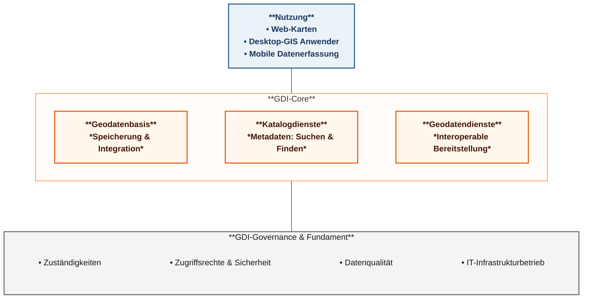

# Projektkonzept VIC-GDI

**Status:** Interner Arbeitsentwurf · fachliche Initiative des GIS-Teams und beteiligter Fachkollegen.

## Was ist eine Geodateninfrastruktur – und wie funktioniert sie?

Viele Informationen, mit denen wir arbeiten, haben einen konkreten räumlichen Bezug: Wo verläuft eine Leitung? Welches Bauwerk ist betroffen? Welche Flurstücke sind betroffen? Welche Schutzgebiete sind im Planungsgebiet zu beachten?

Solche Informationen liegen heute teils an unterschiedlichen Stellen. Wer sie benötigt, muss zunächst den richtigen Datenbestand finden und wissen, ob er aktuell ist. **Eine Geodateninfrastruktur (GDI) schafft dafür eine gemeinsame, verlässliche Grundlage.** Sie organisiert, **wo Informationen geführt werden, wie man sie findet, wie sie bereitgestellt werden und wer dafür verantwortlich ist**. Eine GDI ist somit **kein einzelnes Programm und nicht bloß ein weiterer Server**.

### Drei Funktionsbereiche und ein gemeinsames Fundament

**Lesart:** Das Schaubild zeigt **Aufgabenbereiche**, keine vorgeschriebene Softwareaufteilung und keine technische Reihenfolge. Eine Anwendung kann beispielsweise direkt auf einen Datenbestand zugreifen, ohne zuvor einen Katalog oder Kartendienst zu verwenden. Die drei Bereiche können Funktionen vorhandener Systeme nutzen.

#### Datenhaltung

**Wo liegen die Informationen?**

Benötigte Daten werden geordnet gespeichert und mit einer klaren Zuständigkeit gepflegt, statt unnötig viele voneinander abweichende Kopien zu erzeugen. Das kann Leitungen, Vermessungspunkte oder Projektgebiete betreffen.

#### Katalog 

**Welche Informationen gibt es?**

Vergleichbar mit einem Bibliotheksverzeichnis beschreibt er die vorhandenen Daten: Inhalt, Herkunft, Stand, zuständige Stelle und mögliche Nutzungsbeschränkungen. Die Daten selbst müssen dafür **nicht** im Katalog gespeichert sein.

#### Datenbereitstellung

**Wie kommen die Informationen an?**

Berechtigte Mitarbeitende und Anwendungen können Daten als Karte, als abrufbaren Datensatz oder über einen direkten Datenzugang nutzen. Dabei gelten die jeweils erforderlichen Zugriffsrechte.

#### Nutzung

**Was sieht der Mitarbeiter?**

GIS-Fachprogramme, einfach bedienbare Karten im Browser und mobile Erfassungsanwendungen erfüllen unterschiedliche Aufgaben.

#### Gemeinsames Fundament

**Wer sorgt für Verlässlichkeit?**

Fachbereiche klären Inhalt und Zuständigkeit, das GIS-Team die fachlich-technischen Abläufe und die IT die mit ihr zu vereinbarenden Betriebs- und Sicherheitsaufgaben. Datenqualität, Berechtigungen, Sicherung und Wartung betreffen **alle** Bereiche. Die genaue Betriebsaufteilung ist noch offen.

### Umsetzung dieser Aufgaben in VIC-GDI

Erst auf dieser Ebene werden konkrete Produkte relevant:

| Aufgabe im Modell | Vorgesehener Ansatz in VIC-GDI | Status |
|---|---|---|
| Datenhaltung | **PostgreSQL/PostGIS** als zentrale Basis für Geodaten; weitere Daten verbleiben je nach Art in Dateien oder externen Quellen | Grundsatz beschlossen ([A02](04_ENTSCHEIDUNGEN.md#a02)) |
| Katalog | Schlanke Übersicht zu Datenquellen, Datenständen und Zuständigkeiten | Grundsatz beschlossen, Ausgestaltung/Umfang erneut zu prüfen ([A15](04_ENTSCHEIDUNGEN.md#a15)) |
| Datenbereitstellung | Direkter Datenzugriff, wo sachgerecht; für Webkarten bevorzugt **QGIS Server** | QGIS Server bevorzugt, technische Eignung zu prüfen ([A10](04_ENTSCHEIDUNGEN.md#a10)) |
| Anwendungen | **QGIS Desktop** für Fachanwender, bei Bedarf einfacher Browser-Kartenviewer und **QField** für mobile Abläufe | Unterschiedliche fachliche Festlegungen und Pilotprüfungen ([A11](04_ENTSCHEIDUNGEN.md#a11), [A13](04_ENTSCHEIDUNGEN.md#a13)) |

**Wichtig:** Datenimport, Verarbeitung und Synchronisation sind ergänzende **Arbeitsabläufe**, keine zusätzliche zwingende Säule. Das Modell stellt **weder eine neue Softwareauswahl noch eine Freigabe für Aufbau oder Betrieb** dar. Die tatsächlichen Zugriffswege zeigt die [technische Architekturübersicht](03_ARCHITEKTUR.md#architekturübersicht-logisches-zielbild).

## Ausgangslage

[Geodaten](ANHANG_A_GLOSSAR.md#geodaten) und [QGIS](ANHANG_A_GLOSSAR.md#qgis)-Projekte werden in unterschiedlichen Fachbereichen und Speicherorten verwaltet. Gemeinsame Datennutzung, einheitliche Bereitstellung und kontrollierter Betrieb sollen ermöglicht werden. In der Baubetreuung werden Geodatenquellen und QGIS-Projekte teilweise über synchronisierte SharePoint-/OneDrive-Verzeichnisse genutzt. Diese Arbeitsweise soll kontrolliert abgelöst werden ([A36](04_ENTSCHEIDUNGEN.md#a36)), da sie technisch problematisch ist und bis zum Datenverlust führen kann.

## Warum wir VIC-GDI einführen wollen

Die heutige Arbeit mit Geodaten verteilt sich auf Fachbereiche, Projekte und unterschiedliche Speicherorte. Gemeinsame Bestände sind dadurch nicht vorhanden, bzw. nicht unmittelbar auffindbar; Daten können mehrfach kopiert und unabhängig fortgeschrieben werden. Das erhöht den Abstimmungsaufwand und das Risiko voneinander abweichender Datenstände. **Die Initiative zur Verbesserung geht vom GIS-Team und beteiligten Fachkollegen aus.** Die Bestandsaufnahme mit den Pilotbereichen dient der Priorisierung und passgenauen Einführung, nicht der Grundsatzprüfung, ob eine GDI Vorteile bietet.

Die geplante [Geodateninfrastruktur](ANHANG_A_GLOSSAR.md#gdi) soll **nicht bloß neue Server bereitstellen**, sondern eine gemeinsame, verlässliche Arbeitsgrundlage organisieren:

  - Wo liegt ein führender Datenbestand?
  - Wer verantwortet und pflegt ihn?
  - Wie greifen andere Berechtigte auf denselben freigegebenen Stand zu?
  - Wie können QGIS-Fachanwender, gelegentliche Kartennutzer und mobile Teams aufgabenbezogen arbeiten?

Die GDI **ergänzt** vorhandene CAD-, BIM- und Fachsysteme; sie ersetzt sie nicht.

### Heutige Herausforderungen und angestrebte Verbesserung

| Heutige Herausforderung | Angestrebte Verbesserung durch VIC-GDI |
|---|---|
| Daten, QGIS-Projekte und Zuständigkeiten verteilen sich auf verschiedene Ablagen. | Nachvollziehbare Quellen, klare Datenhoheit und verlässliche Zugriffswege. |
| Geeignete Bestände werden zwischen Projekten kopiert und ggf. unterschiedlich weitergeführt. | Gemeinsame Nutzung führender Daten statt unnötiger unabhängiger Kopien. |
| Herkunft, Aktualität oder Freigabestand sind nicht immer unmittelbar erkennbar. | Verantwortliche und relevante Datenstände nachvollziehbar machen. |
| Gelegentliche Kartenfragen erfordern teilweise GIS-Unterstützung. | Bei Bedarf einfache, berechtigungsgesteuerte Webkarten für Nicht-Spezialisten. |
| Mobile Erfassungen müssen in den fachlich geprüften Bestand übernommen werden. | Übertragung, fachliche Prüfung und Freigabe klar unterscheiden. |
| Wiederkehrende Konfigurationen und Betriebswissen sind uneinheitlich verteilt. | Gemeinsame Ressourcen und dokumentierte, vertretbare Abläufe. |

### Zielprinzip auf einen Blick

**Für gemeinsame Daten gilt: Ein fachlich verantworteter Bestand statt unnötiger unabhängiger Arbeitskopien.** Fachprogramme und berechtigte Browseransichten können dieselben freigegebenen Informationen nutzen. Das [einfach erklärte Funktionsmodell](#was-ist-eine-geodateninfrastruktur--und-wie-funktioniert-sie) zeigt die Zusammenhänge. Nicht sämtliche QGIS-Projekte und Rasterdateien müssen dafür in der zentralen Datenbank liegen.

### Was das im Arbeitsalltag bedeuten kann

- **Baubetreuung:** Ein mobil erfasster Leitungsverlauf wird übertragen, geprüft und – nur bei fachlicher Eignung – in einen führenden Bestand übernommen. Die Synchronisation ist keine automatische Freigabe ([BB-01](05_PILOTKONKRETISIERUNG.md#bb-01)).
- **Verkehrsanlagenplanung:** Zwei Planungsprojekte verwenden einen gemeinsamen Geodatenbestand, anstatt eigene Kopien mit möglicherweise verschiedenen Aktualisierungsständen zu pflegen.
- **Gelegentliche Kartennutzung:** Wer kein QGIS benötigt oder nutzen kann, kann bei entsprechendem Bedarf freigegebene Karten im Browser einsehen.

### Nutzen der GDI erschließen und die Einführung gezielt gestalten

Eine gemeinsame Geodateninfrastruktur bietet gegenüber einer dezentralen, teils redundanten Ablage **klare strukturelle Vorteile**: Datenbestände können an einer verantwortlichen Stelle gepflegt, berechtigt gemeinsam genutzt und in verschiedenen Fachabläufen wiederverwendet werden. **Fachlich** verbessert das die Grundlage für aktuelle, nachvollziehbare Datenstände; **organisatorisch** reduziert es unnötige Kopier- und Abstimmungswege; **technisch** ermöglicht es standardisierte, wartbare Zugriffs- und Bereitstellungswege.

**Die Piloten sind erste Schritte der GDI-Einführung und keine Experimente zur grundsätzlichen Sinnhaftigkeit.** Mit ihnen werden relevante Arbeitsabläufe priorisiert, Datenmodelle und Schnittstellen abgestimmt, Funktionen eingeführt und die Betriebsfähigkeit überprüft. Fachliche Abnahme und geeignete Vergleichsgrößen zeigen anschließend, **wie gut** die Vorteile im jeweiligen Ablauf realisiert wurden. Quantifizierte Zeit- oder Kosteneinsparungen werden ohne belastbare Ausgangsdaten nicht versprochen.

## Ziele

- Fachbereichsneutrale, interne [Geodateninfrastruktur](ANHANG_A_GLOSSAR.md#gdi).
- Schrittweise ausbaubar und erweiterbar.
- Verlässliche gemeinsame Datenhaltung mit eindeutiger fachlicher Zuständigkeit.
- QGIS Desktop als zentraler Client; einfache Webkarten für Gelegenheitsnutzer; geeignete mobile Workflows.
- Sichere Nutzung im Unternehmensnetz bzw. über [VPN](ANHANG_A_GLOSSAR.md#vpn); kontrollierte externe Zusammenarbeit bei Bedarf.
- Möglichst Standardtechnologien statt eigener Entwicklungen.
- Beherrschbarer Einführungs-, Betriebs- und Schulungsaufwand.

## Pilotbereiche

1. **Baubetreuung:** räumlich bezogene Vorgänge, Karten, geeignete mobile Arbeitsabläufe.
2. **Verkehrsanlagenplanung:** projektbezogene und gemeinsam genutzte Geodaten, QGIS-Arbeitsabläufe.

Diese Pilotbereiche bilden die ersten **praktischen Einführungsschritte**. Sie dürfen unterschiedliche fachliche Anforderungen und Einführungszeitpunkte haben, ein identischer Funktionsumfang ist nicht erforderlich ([A34](04_ENTSCHEIDUNGEN.md#a34)).

## Abgrenzung

- Kein öffentliches anonymes GIS-Portal als primäres Ziel.
- Die GDI ergänzt [CAD](ANHANG_A_GLOSSAR.md#cad)-, [BIM](ANHANG_A_GLOSSAR.md#bim)- und Fachanwendungen um eine gemeinsame Geodatenbasis.
- Keine Eigenentwicklung eines Offline-Synchronisationssystems.
- Kein umfassendes formales Qualitätsmanagement für amtliche Geobasisdaten.
- Kein umfangreiches [ITSM](ANHANG_A_GLOSSAR.md#itsm)-, [CI/CD](ANHANG_A_GLOSSAR.md#ci-cd)- oder [HA](ANHANG_A_GLOSSAR.md#ha)-System ohne nachgewiesenen Bedarf.

## Projektgrundsätze

Die folgenden **übergeordneten Leitplanken** bündeln die im [Festlegungs- und Entscheidungsregister](04_ENTSCHEIDUNGEN.md) dokumentierten Vorgaben. Sie sind kein zweiter Beschlusskatalog: **Status, konkrete Festlegungen und noch offene Ausgestaltungen werden ausschließlich dort geführt.**

1. **Fachbereichsneutralität:** Eine gemeinsame, schrittweise erweiterbare GDI für mehrere Fachbereiche; Baubetreuung und Verkehrsanlagenplanung bilden die ersten beiden Piloten ([A01](04_ENTSCHEIDUNGEN.md#a01), [A34](04_ENTSCHEIDUNGEN.md#a34)).
2. **Gemeinsame PostGIS-Basis:** PostgreSQL/PostGIS ist die gesetzte zentrale Geodatenbasis für geeignete gemeinsam genutzte Bestände. Eine gemeinsame Datenbank mit fachlichen Schemas konkretisiert die Architektur; kein Zwang, alle Dateien oder Datenarten dorthin zu verlagern ([A02](04_ENTSCHEIDUNGEN.md#a02)).
3. **Datenhoheit statt Dubletten:** Führende fachliche Verantwortung und gemeinsame Projektidentität; gemeinsame Nutzung nur mit wirksamen, zuständigkeitsabhängigen Rechten ([A08](04_ENTSCHEIDUNGEN.md#a08), [A09](04_ENTSCHEIDUNGEN.md#a09)).
4. **Klare fachliche Abgrenzung:** Schlanke Projektstammdaten und Geodatenbereitstellung statt eigenem Projektmanagement- oder universellen Fachinformationssystem ([A07](04_ENTSCHEIDUNGEN.md#a07)).
5. **Standard vor Eigenentwicklung:** Etablierte freie GIS-Werkzeuge und vorhandene Funktionen bevorzugen; zusätzliche Dienste und Automatisierung nur bei bestätigtem Bedarf ([A11](04_ENTSCHEIDUNGEN.md#a11), [A13](04_ENTSCHEIDUNGEN.md#a13), [A14](04_ENTSCHEIDUNGEN.md#a14)).
6. **Sicherheit und Nachvollziehbarkeit:** Rechte an jedem tatsächlich genutzten Datenzugriff durchsetzen, kontrollierte Änderungen und geeignete Versionierung; technische Details mit IT klären ([A09](04_ENTSCHEIDUNGEN.md#a09), [A26](04_ENTSCHEIDUNGEN.md#a26), [A30](04_ENTSCHEIDUNGEN.md#a30)).
7. **Bedarfsgerechte Einführung:** Gemeinsam nutzbare Grundfunktionen und fachliche Pilotumfänge unterscheiden; kontrollierte selektive Migration statt pauschaler Ablösung bestehender Fachsysteme ([A34](04_ENTSCHEIDUNGEN.md#a34)–[A36](04_ENTSCHEIDUNGEN.md#a36)).
8. **Dauerhafte Handlungsfähigkeit:** Rollenbezogenen Wissensaufbau einschließlich realer Ressourcen planen; Betrieb und Verantwortlichkeiten mit IT und Geschäftsführung tragfähig klären ([A31](04_ENTSCHEIDUNGEN.md#a31)–[A33](04_ENTSCHEIDUNGEN.md#a33), [A39](04_ENTSCHEIDUNGEN.md#a39)).

**Gültigkeitsgrenze:** Projektgrundsätze und fachliche Festlegungen sind nicht mit einer bereits erfolgten Umsetzungs-, Budget- oder IT-Betriebsfreigabe gleichzusetzen. [Technisches Zielbild](03_ARCHITEKTUR.md), [offene Fragen](08_OFFENE_PUNKTE.md).
