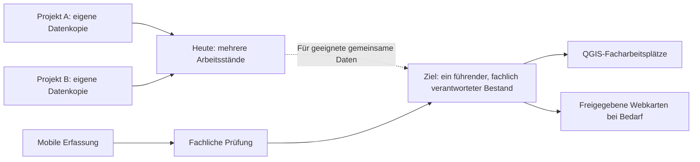

# Projektkonzept VIC-GDI

**Status:** Interner Arbeitsentwurf · fachliche Initiative des GIS-Teams und beteiligter Fachkollegen; Umsetzungs-, Budget- und Betriebsfreigabe durch GF/IT noch offen.

## Ausgangslage

[Geodaten](ANHANG_A_GLOSSAR.md#geodaten) und [QGIS](ANHANG_A_GLOSSAR.md#qgis)-Projekte werden in unterschiedlichen Fachbereichen und Speicherorten verwaltet. Gemeinsame Datennutzung, einheitliche Bereitstellung und kontrollierter Betrieb sollen verbessert werden. In der Baubetreuung werden QGIS-Arbeitsbestände teilweise über synchronisierte SharePoint-/OneDrive-Verzeichnisse genutzt; diese Arbeitsweise soll für führende [GIS](ANHANG_A_GLOSSAR.md#gis)-Arbeitsdaten kontrolliert abgelöst werden ([A36](04_ENTSCHEIDUNGEN.md#a36)).

## Warum wir VIC-GDI einführen wollen

Die heutige Arbeit mit Geodaten verteilt sich auf Fachbereiche, Projekte und unterschiedliche Speicherorte. Gemeinsame Bestände sind dadurch nicht immer unmittelbar auffindbar; Daten können mehrfach kopiert und unabhängig fortgeschrieben werden. Das erhöht den Abstimmungsaufwand und das Risiko voneinander abweichender Datenstände. In der Baubetreuung werden GIS-Arbeitsbestände teilweise über synchronisierte SharePoint-/OneDrive-Verzeichnisse genutzt; diese Arbeitsweise soll für führende Arbeitsdaten kontrolliert abgelöst werden. **Die Initiative zur Verbesserung geht vom GIS-Team und beteiligten Fachkollegen aus.** Die Bestandsaufnahme mit den Pilotbereichen dient der Priorisierung und passgenauen Einführung, nicht der Grundsatzprüfung, ob eine GDI Vorteile bietet.

Die geplante [Geodateninfrastruktur](ANHANG_A_GLOSSAR.md#gdi) soll **nicht bloß neue Server bereitstellen**, sondern eine gemeinsame, verlässliche Arbeitsgrundlage organisieren: Wo liegt ein führender Datenbestand? Wer verantwortet und pflegt ihn? Wie greifen andere Berechtigte auf denselben freigegebenen Stand zu? Wie können QGIS-Fachanwender, gelegentliche Kartennutzer und mobile Teams aufgabenbezogen arbeiten? Die GDI **ergänzt** vorhandene CAD-, BIM-, M365- und Fachsysteme; sie ersetzt sie nicht.

### Heutige Herausforderungen und angestrebte Verbesserung

| Heutige Herausforderung | Angestrebte Verbesserung durch VIC-GDI |
|---|---|
| Daten, QGIS-Projekte und Zuständigkeiten verteilen sich auf verschiedene Ablagen. | Nachvollziehbare Quellen, klare Datenhoheit und verlässliche Zugriffswege. |
| Geeignete Bestände werden zwischen Projekten kopiert und ggf. unterschiedlich weitergeführt. | Gemeinsame Nutzung führender Daten statt unnötiger unabhängiger Kopien. |
| Herkunft, Aktualität oder Freigabestand sind nicht immer unmittelbar erkennbar. | Verantwortliche und relevante Datenstände nachvollziehbar machen. |
| Gelegentliche Kartenfragen erfordern teilweise GIS-Unterstützung. | Bei Bedarf einfache, berechtigungsgesteuerte Webkarten für Nicht-Spezialisten. |
| Mobile Erfassungen müssen in den fachlich geprüften Bestand übernommen werden. | Übertragung, fachliche Prüfung und Freigabe klar unterscheiden. |
| Wiederkehrende Konfigurationen und Betriebswissen sind uneinheitlich verteilt. | Gemeinsame Ressourcen und dokumentierte, vertretbare Abläufe. |

### Zielprinzip auf einen Blick

**Einordnung:** Das Diagramm illustriert ein Zielprinzip, keinen nachgewiesenen heutigen Ablauf und keine Pflicht, sämtliche QGIS-Projekte, Raster- oder CAD-Dateien in PostGIS zu speichern. Der mobile Datenweg und die Webbereitstellung sind pilotabhängig.

### Was das im Arbeitsalltag bedeuten kann

- **Baubetreuung:** Ein mobil erfasster Leitungsverlauf wird übertragen, geprüft und – nur bei fachlicher Eignung – in einen führenden Bestand übernommen. Die Synchronisation ist keine automatische Freigabe ([BB-01](05_PILOTKONKRETISIERUNG.md#bb-01)).
- **Verkehrsanlagenplanung:** Zwei Planungsprojekte verwenden einen geeigneten gemeinsamen Geodatenbestand, anstatt eigene Kopien mit möglicherweise verschiedenen Aktualisierungsständen zu pflegen.
- **Gelegentliche Kartennutzung:** Wer kein QGIS benötigt, kann bei entsprechendem Pilotbedarf freigegebene Karten im Browser einsehen, ohne die führenden Daten verändern zu können.

### Nutzen der GDI erschließen und die Einführung gezielt gestalten

Eine gemeinsame Geodateninfrastruktur bietet gegenüber einer dezentralen, teils redundanten Ablage **klare strukturelle Vorteile**: geeignete Datenbestände können an einer verantwortlichen Stelle gepflegt, berechtigt gemeinsam genutzt und in verschiedenen Fachabläufen wiederverwendet werden. **Fachlich** verbessert das die Grundlage für aktuelle, nachvollziehbare Datenstände; **organisatorisch** reduziert es unnötige Kopier- und Abstimmungswege; **technisch** ermöglicht es standardisierte, wartbare Zugriffs- und Bereitstellungswege.

**Die Piloten sind erste Schritte der GDI-Einführung und keine Experimente zur grundsätzlichen Sinnhaftigkeit.** Mit ihnen werden relevante Arbeitsabläufe priorisiert, Datenmodelle und Schnittstellen abgestimmt, Funktionen eingeführt und die Betriebsfähigkeit überprüft. Fachliche Abnahme und geeignete Vergleichsgrößen zeigen anschließend, **wie gut** die Vorteile im jeweiligen Ablauf realisiert wurden. Quantifizierte Zeit- oder Kosteneinsparungen werden ohne belastbare Ausgangsdaten nicht versprochen. Aufwand und laufender Betrieb sind für die **konkreten Umsetzungsvarianten** verantwortlich zu planen; dies stellt die strategische Zielsetzung nicht infrage.

## Ziele

- Fachbereichsneutrale, interne [Geodateninfrastruktur](ANHANG_A_GLOSSAR.md#gdi).
- Schrittweise ausbaubar und erweiterbar.
- Verlässliche gemeinsame Datenhaltung mit eindeutiger fachlicher Zuständigkeit.
- QGIS Desktop als zentraler Fachclient; einfache Webkarten für Gelegenheitsnutzer; geeignete mobile Workflows.
- Sichere Nutzung im Unternehmensnetz bzw. über [VPN](ANHANG_A_GLOSSAR.md#vpn); kontrollierte externe Zusammenarbeit bei Bedarf.
- Möglichst Standardtechnologien statt eigener GIS-Basisentwicklungen.
- Beherrschbarer Einführungs-, Betriebs- und Schulungsaufwand.

## Pilotbereiche

1. **Baubetreuung:** räumlich bezogene Vorgänge, Karten, geeignete mobile Arbeitsabläufe.
2. **Verkehrsanlagenplanung:** projektbezogene und gemeinsam genutzte Geodaten, QGIS-Arbeitsabläufe.

Diese Pilotbereiche bilden die ersten **praktischen Einführungsschritte**. Sie dürfen unterschiedliche fachliche Anforderungen und Einführungszeitpunkte haben; ein identischer Funktionsumfang ist nicht erforderlich ([A34](04_ENTSCHEIDUNGEN.md#a34)).

## Abgrenzung

- Kein öffentliches anonymes GIS-Portal als primäres Ziel.
- Die GDI ergänzt [CAD](ANHANG_A_GLOSSAR.md#cad)-, [BIM](ANHANG_A_GLOSSAR.md#bim)-, M365- und Fachanwendungen um eine gemeinsame Geodatenbasis.
- Keine vollständige Migration aller Dateiformate nach [PostGIS](ANHANG_A_GLOSSAR.md#postgis).
- Keine Eigenentwicklung eines Offline-Synchronisationssystems.
- Kein umfassendes formales Qualitätsmanagement für amtliche Geobasisdaten.
- Kein umfangreiches [ITSM](ANHANG_A_GLOSSAR.md#itsm)-, [CI/CD](ANHANG_A_GLOSSAR.md#ci-cd)- oder [HA](ANHANG_A_GLOSSAR.md#ha)-System ohne nachgewiesenen Bedarf.

## Projektgrundsätze

Die folgenden **übergeordneten Leitplanken** bündeln die im [Festlegungs- und Entscheidungsregister](04_ENTSCHEIDUNGEN.md) dokumentierten Vorgaben. Sie sind kein zweiter Beschlusskatalog: **Status, konkrete Festlegungen und noch offene Ausgestaltungen werden ausschließlich dort geführt.**

1. **Fachbereichsneutralität:** Eine gemeinsame, schrittweise erweiterbare GDI für mehrere Fachbereiche; Baubetreuung und Verkehrsanlagenplanung bilden die ersten beiden Piloten ([A01](04_ENTSCHEIDUNGEN.md#a01), [A34](04_ENTSCHEIDUNGEN.md#a34)).
2. **Gemeinsame PostGIS-Basis:** PostgreSQL/PostGIS ist die gesetzte zentrale Geodatenbasis für geeignete gemeinsam genutzte Bestände. Eine gemeinsame Datenbank mit fachlichen Schemas konkretisiert die Architektur; kein Zwang, alle Dateien oder Datenarten dorthin zu verlagern ([A02](04_ENTSCHEIDUNGEN.md#a02)).
3. **Datenhoheit statt Dubletten:** Führende fachliche Verantwortung und gemeinsame Projektidentität; gemeinsame Nutzung nur mit wirksamen, zuständigkeitsabhängigen Rechten ([A08](04_ENTSCHEIDUNGEN.md#a08), [A09](04_ENTSCHEIDUNGEN.md#a09)).
4. **Klare fachliche Abgrenzung:** Schlanke Projektstammdaten und Geodatenbereitstellung statt eigenem Projektmanagement- oder universellen Fachinformationssystem ([A07](04_ENTSCHEIDUNGEN.md#a07)).
5. **Standard vor Eigenentwicklung:** Etablierte freie GIS-Werkzeuge und vorhandene Funktionen bevorzugen; zusätzliche Dienste und Automatisierung nur bei bestätigtem Bedarf ([A11](04_ENTSCHEIDUNGEN.md#a11), [A13](04_ENTSCHEIDUNGEN.md#a13), [A14](04_ENTSCHEIDUNGEN.md#a14)).
6. **Sicherheit und Nachvollziehbarkeit:** Rechte an jedem tatsächlich genutzten Datenzugriff durchsetzen, kontrollierte Änderungen und geeignete Versionierung; technische Details mit IT klären ([A09](04_ENTSCHEIDUNGEN.md#a09), [A26](04_ENTSCHEIDUNGEN.md#a26), [A30](04_ENTSCHEIDUNGEN.md#a30)).
7. **Bedarfsgerechte Einführung:** Gemeinsam nutzbare Grundfunktionen und fachliche Pilotumfänge unterscheiden; kontrollierte selektive Migration statt pauschaler Ablösung bestehender Fachsysteme ([A34](04_ENTSCHEIDUNGEN.md#a34)–[A36](04_ENTSCHEIDUNGEN.md#a36)).
8. **Dauerhafte Handlungsfähigkeit:** Rollenbezogenen Wissensaufbau einschließlich realer Ressourcen planen; Betrieb und Verantwortlichkeiten mit IT und Geschäftsführung tragfähig klären ([A31](04_ENTSCHEIDUNGEN.md#a31)–[A33](04_ENTSCHEIDUNGEN.md#a33), [A39](04_ENTSCHEIDUNGEN.md#a39)).

**Gültigkeitsgrenze:** Projektgrundsätze und fachliche Festlegungen sind nicht mit einer bereits erfolgten Umsetzungs-, Budget- oder IT-Betriebsfreigabe gleichzusetzen. [Technisches Zielbild](03_ARCHITEKTUR.md), [offene Fragen](08_OFFENE_PUNKTE.md).
