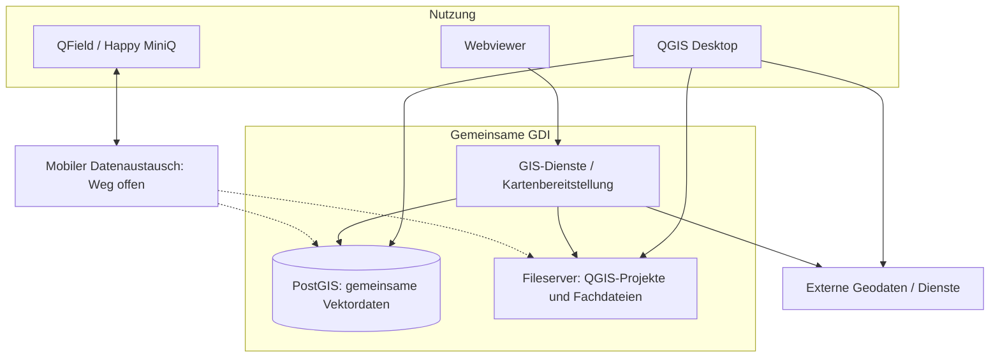

# Zielarchitektur VIC-GDI

**Status:** Interner Arbeitsentwurf · beschlossene Grundsätze und noch offene technische Festlegungen getrennt.

Die Architektur zeigt den bisherigen Beschlussstand. Zentrale [PostgreSQL](ANHANG_A_GLOSSAR.md#postgresql)-Projektablage und erweiterter interner Katalog mit hybrider Metadatenpflege sind [Prüfvarianten](04_ENTSCHEIDUNGEN.md#erneute-prüfung-a04-a15-und-a36) zu [A04](04_ENTSCHEIDUNGEN.md#a04), [A15](04_ENTSCHEIDUNGEN.md#a15) und [A36](04_ENTSCHEIDUNGEN.md#a36).

## Logische Architektur

- **Clients:** [QGIS](ANHANG_A_GLOSSAR.md#qgis) Desktop als Facharbeitsplatz; [Webviewer](ANHANG_A_GLOSSAR.md#webviewer) für vereinfachte und erweiterte Kartennutzung; [QField](ANHANG_A_GLOSSAR.md#qfield)/[HAPPY MINI Q](ANHANG_A_GLOSSAR.md#happy-mini-q) für geeignete mobile Online-/Offline-Szenarien.
- **Daten:** Gemeinsame PostgreSQL/[PostGIS](ANHANG_A_GLOSSAR.md#postgis)-Instanz mit fachbereichsbezogenen Schemas; projektbezogene Zuordnung über `project_id` nur, wo fachlich sinnvoll ([A02](04_ENTSCHEIDUNGEN.md#a02), [A03](04_ENTSCHEIDUNGEN.md#a03)).
- **Fachprojekte:** QGIS-Projekte bleiben fachbereichs- bzw. projektbezogen; zentral gepflegte Verbindungen, Vorlagen und [QML](ANHANG_A_GLOSSAR.md#qml)-Stile können wiederverwendet und überschrieben werden ([A04](04_ENTSCHEIDUNGEN.md#a04), [A17](04_ENTSCHEIDUNGEN.md#a17)).
- **Dienste:** [QGIS Server](ANHANG_A_GLOSSAR.md#qgis-server) bevorzugt, vorbehaltlich technischem [PoC](ANHANG_A_GLOSSAR.md#poc); Standard-Webviewer (z. B. [Lizmap](ANHANG_A_GLOSSAR.md#lizmap)/[QWC2](ANHANG_A_GLOSSAR.md#qwc2)) mit begrenzten Anpassungen; Webpublikation über getrennte Kartenprojekte ([A10](04_ENTSCHEIDUNGEN.md#a10), [A11](04_ENTSCHEIDUNGEN.md#a11), [A18](04_ENTSCHEIDUNGEN.md#a18)).
- **Zusatzfunktionen:** Schlanke integrierte Suche und [Geodatenauszug](ANHANG_A_GLOSSAR.md#extract) mit eigener Rechteprüfung ([A12](04_ENTSCHEIDUNGEN.md#a12), [A20](04_ENTSCHEIDUNGEN.md#a20)). Der Geodatenauszug ist nach [A12](04_ENTSCHEIDUNGEN.md#a12) als **Funktion**, nicht als separater Extract-Service beschlossen. Für priorisierten Pilotbedarf zuerst vorhandene QGIS-, Viewer- und Dienstfunktionen prüfen; einen eigenständigen Dienst nur bei nachgewiesenem Mehrbedarf vorsehen.
- **Betrieb:** On-prem auf [Proxmox](ANHANG_A_GLOSSAR.md#proxmox) bevorzugt, hybride Varianten möglich; konkrete Container-/[VM](ANHANG_A_GLOSSAR.md#vm)-Verteilung mit IT entscheiden ([A23](04_ENTSCHEIDUNGEN.md#a23), [A24](04_ENTSCHEIDUNGEN.md#a24)).

**Lizenz-/Kostenprinzip:** Die hier vorgesehenen GDI-Kernkomponenten sind freie Open-Source-Software ohne zusätzliche Softwarelizenzgebühren. Proxmox VE ist ebenfalls ohne verpflichtende kostenpflichtige Lizenz nutzbar; eine Subskription für Enterprise-Repository/Support kann sich betrieblich empfehlen. Optional benötigte Drittanbieter-Dienste, Betriebsressourcen und die konkrete Softwarestückliste werden getrennt geprüft. Siehe [Software-/Lizenzübersicht](software/README.md#lizenz--und-kostenüberblick-gdi-kern) und [A39-Kostenrahmen](06_UMSETZUNGS_UND_BETRIEBSMODELLE.md#kostenrahmen-und-lizenzabgrenzung). Dies legt keine der offenen Deploymentvarianten [A24](04_ENTSCHEIDUNGEN.md#a24) fest.

### Architekturübersicht (logisches Zielbild)

Das Diagramm zeigt die **wesentlichen Nutzungspfade und Datenhaltungen**, ohne einzelne technische Dienste oder Server aufzuschlüsseln. Der mobile Austausch ist noch zu validieren; gestrichelte Linien markieren mögliche, noch nicht festgelegte Zielanbindungen. Identität, Berechtigungen, Betrieb und Deployment gelten übergreifend und sind bewusst nicht als zusätzliche Pfeile dargestellt.

**Lesart:** QGIS Desktop arbeitet je nach Datenart mit PostGIS, Fileservern und externen Diensten. Der Webviewer nutzt [GIS](ANHANG_A_GLOSSAR.md#gis)-Dienste zur Kartenbereitstellung. Fachdateien verbleiben bei Bedarf auf dem Fileserver; geeignete gemeinsam bearbeitete Vektordaten liegen in PostGIS. Der mobile Rückweg und die Sicherheitsintegration sind noch zu konkretisieren.

## Datenorganisation

- Eine gemeinsame Projektidentität; schlanke Projektstammdaten und optionale räumliche Projektabgrenzung ([A06–A08](04_ENTSCHEIDUNGEN.md#a06)).
- Führende Stelle je gemeinsam genutztem Datenbestand; gemeinsame lesende Nutzung nach Freigabe, Schreibrechte nach Zuständigkeit ([A08](04_ENTSCHEIDUNGEN.md#a08), [A09](04_ENTSCHEIDUNGEN.md#a09)).
- Gemeinsam bearbeitete geeignete Vektordaten in PostGIS, QGIS-Projekte und geeignete Dateien auf Fileservern; keine pauschale Datenbankpflicht ([A36](04_ENTSCHEIDUNGEN.md#a36)).
- Amtliche externe Daten bevorzugt live nutzen; bei fachlicher Notwendigkeit unveränderliche, nachvollziehbare Datenstände anlegen ([A05](04_ENTSCHEIDUNGEN.md#a05)).
- Externe Rasterdienste bevorzugen; lokale [GeoTIFF](ANHANG_A_GLOSSAR.md#geotiff)/[COG](ANHANG_A_GLOSSAR.md#cog) für Analyse und Reproduzierbarkeit, kein genereller PostGIS-Raster-Zwang ([A22](04_ENTSCHEIDUNGEN.md#a22)).
- ETRS89/[UTM](ANHANG_A_GLOSSAR.md#utm) EPSG:25832 oder 25833 nach räumlichem Bezug bevorzugen; **DHDN / Soldner Berlin (EPSG:3068)** ist zusätzlich ein explizit zu unterstützendes Projekt-/Export-CRS. Transformationen einschließlich verfügbarer Gitter, Genauigkeit und Achsreihenfolge sowie Höhenbezüge getrennt prüfen ([A21](04_ENTSCHEIDUNGEN.md#a21)).

## GIS-Funktionen

- **Suche:** Projekte, Orte/Adressen und ausgewählte GIS-Objekte; Ergebnisse nur entsprechend Berechtigung ([A20](04_ENTSCHEIDUNGEN.md#a20)).
- **Auszug:** Der berechtigte Geodatenauszug ist als **Funktion**, nicht als eigener Dienst beschlossen. Objektselektion vollständig als Standard, geometrisches Clipping optional; Austauschformate und CRS sind fachlich festgelegt ([A12](04_ENTSCHEIDUNGEN.md#a12), [A21](04_ENTSCHEIDUNGEN.md#a21)). **Rechteausgestaltung bleibt offen** ([A26](04_ENTSCHEIDUNGEN.md#a26)); kein ungeschützter Exportweg darf produktiv freigegeben werden. Technische Detailanforderungen (GeoJSON-Version/CRS, DXF, EPSG:3068, GDAL-Tests) stehen an einer Stelle im [SW-06-Prüfkatalog](software/06_GEODATENAUSZUG.md), nicht zusätzlich als Implementierungsanweisung hier.
- **Mobil:** Vorhandene Synchronisationsmechanismen verwenden; Konfliktbehandlung und Rückübertragung pilotieren, keine eigene Offline-Engine ([A13](04_ENTSCHEIDUNGEN.md#a13)).
- **[ETL](ANHANG_A_GLOSSAR.md#etl):** Manuelle Verfahren und Skripte zuerst; kontrollierte Staging-/Importprüfungen, später selektiv automatisieren ([A14](04_ENTSCHEIDUNGEN.md#a14)).
- **Metadaten:** Schlanker Katalog für Quelle, Datensatz und Dienst; je Layer u. a. Herkunft, Datenstand, Lizenz, Importzeit, CRS ([A15](04_ENTSCHEIDUNGEN.md#a15)).
- **Qualität:** Amtliche Daten nur auf technische Import-/Transformationsfehler prüfen; eigene gemeinsame Daten fachlich im normalen Arbeitsprozess plausibilisieren, ohne formalen Freigabeapparat ([A16](04_ENTSCHEIDUNGEN.md#a16)).

## Sicherheits- und Betriebsprinzipien

- Rechte nicht allein über ausgeblendete UI-Elemente, sondern auf den jeweiligen Server-/Datenzugriffspfaden durchsetzen ([A09](04_ENTSCHEIDUNGEN.md#a09), [A26](04_ENTSCHEIDUNGEN.md#a26)).
- Vorhandene Unternehmensidentitäten bevorzugt nutzen. IT klärt, welche Rolle [AD DS](ANHANG_A_GLOSSAR.md#ad) und [Microsoft Entra ID](ANHANG_A_GLOSSAR.md#entra-id) für Browseranmeldung, direkten Datenbankzugriff und externe Konten übernehmen können ([A25](04_ENTSCHEIDUNGEN.md#a25)).
- Getrennte TEST-/PROD-Umgebung, versionierte Konfiguration und Datenbankmigrationen, kontrollierte Bereitstellung ([A27](04_ENTSCHEIDUNGEN.md#a27), [A30](04_ENTSCHEIDUNGEN.md#a30)).
- Bestehende IT-Backups und Monitoring nutzen, um [GDI](ANHANG_A_GLOSSAR.md#gdi)-spezifische Prüfungen und Restore-Tests ergänzen ([A28](04_ENTSCHEIDUNGEN.md#a28), [A29](04_ENTSCHEIDUNGEN.md#a29)).

Die noch offenen produktbezogenen Auswahlfragen sind als [einheitlich bewertete Softwarekategorien](software/README.md) vorbereitet. Die Kandidaten dort sind **Prüfoptionen, keine zusätzlichen Architekturfestlegungen**; der reale Pilotbedarf entscheidet, ob ein eigener Katalog- oder Auszugsdienst überhaupt benötigt wird.

## Bewusst nicht festgelegt

Deploymentmodell [A24](04_ENTSCHEIDUNGEN.md#a24), Details des Identitäts- und Berechtigungsmodells, Datenlebenszyklus [A37](04_ENTSCHEIDUNGEN.md#a37) und konkrete Datenbankvalidierung [A38](04_ENTSCHEIDUNGEN.md#a38). Diese Themen sind in [08_OFFENE_PUNKTE.md](08_OFFENE_PUNKTE.md) dokumentiert. Nicht jede hier genannte bevorzugte Technologie ist bereits technisch freigegeben.
