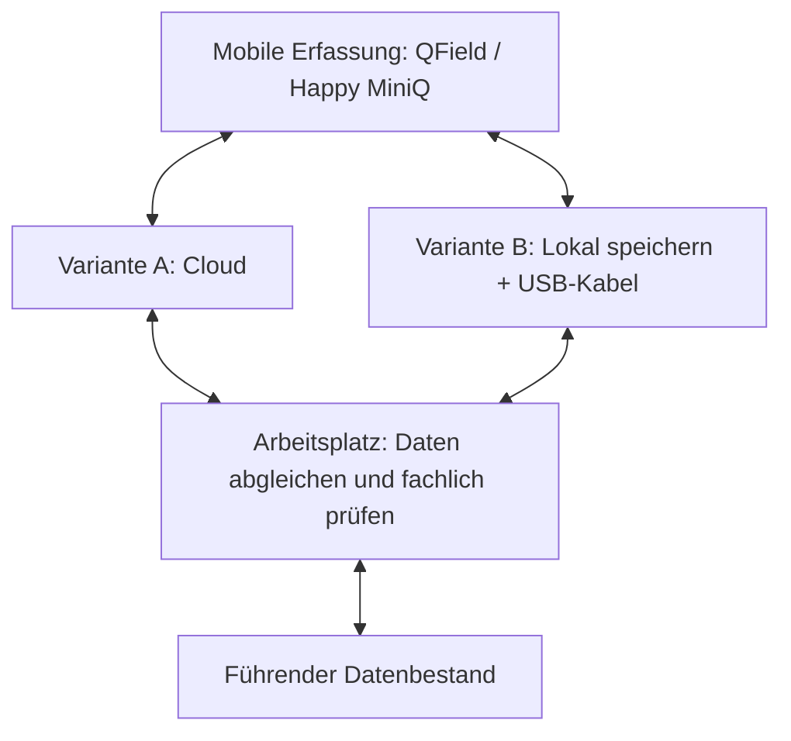

# Pilotkonkretisierung – Baubetreuung und Verkehrsanlagenplanung

**Status:** Interner Arbeitsentwurf. Fachlich benannte Tätigkeiten und bestehende mobile Praxis sind gekennzeichnet. Pilotumfang und Sollabläufe stehen zur Auswahl. Quelle der beschlossenen Rahmenbedingungen: [Entscheidungen](04_ENTSCHEIDUNGEN.md), insbesondere [A01](04_ENTSCHEIDUNGEN.md#a01), [A04](04_ENTSCHEIDUNGEN.md#a04), [A09](04_ENTSCHEIDUNGEN.md#a09), [A13](04_ENTSCHEIDUNGEN.md#a13), [A34–A36](04_ENTSCHEIDUNGEN.md#a34).

## Ziel und Vorgehen

Die Piloten sollen die gemeinsame [GDI](ANHANG_A_GLOSSAR.md#gdi)-Basis anhand realer Arbeitsabläufe überprüfen. Nicht beide Fachbereiche müssen dieselben Funktionen benötigen. Pro Pilot zunächst **ein bis zwei häufige oder problematische Abläufe** auswählen, vorhandene Daten/Programme prüfen, minimalen Sollablauf beschreiben, danach Akzeptanzkriterien und [MVP](ANHANG_A_GLOSSAR.md#mvp)-Umfang festlegen. Keine zusätzlichen Architekturentscheidungen aus unbestätigten Annahmen ableiten.

## Pilot 1 – Baubetreuung / Bauüberwachung

**Gesichert:** Baubetreuung ist Pilotbereich; bisherige führende [QGIS](ANHANG_A_GLOSSAR.md#qgis)-Arbeitsdaten in synchronisierten SharePoint-/OneDrive-Verzeichnissen verursachen Probleme. [A36](04_ENTSCHEIDUNGEN.md#a36) legt eine kontrollierte selektive Migration fest.

**Prüfhypothesen, nicht beschlossen:**
- Projektbezogene Geodaten und Pläne sicher finden, anzeigen und mit geeigneten Informationen verknüpfen.
- Vor Ort auf Tablet/mobilem Gerät Karten verwenden; Online-/Offline-Bedarf tatsächlich ermitteln.
- Gemeinsame Vektordaten ohne Synchronisationskonflikte bearbeiten; andere Dateien geeignet auf Fileservern verwalten.

**Zuerst klären:**
1. Welche zwei konkreten Tätigkeiten werden heute in QGIS durchgeführt und wie häufig?
2. Welche Projektdateien, Layer, Dateiformate und Pfade werden tatsächlich benutzt?
3. Wer bearbeitet dieselben Daten gleichzeitig; welche Konflikte sind bereits aufgetreten?
4. Ist mobile Erfassung nötig oder reicht lesender Karten-/Plan-Zugriff?
5. Welche Offline-Situationen, Geräte, Berechtigungen und Freigaben sind relevant?

**Möglicher erster Testfall:** Ein bestehendes QGIS-Projekt mit realen, nicht sensitiven bzw. freigegebenen Testdaten auf geeignete Datenhaltung umstellen; Datenquellen, Pfade, gleichzeitige Nutzung und Rechte testen. Nur nach fachlicher Bestätigung priorisieren.

## Fachlich benannte Anwendungsfälle der Baubetreuung

Die Baubetreuung beginnt erst mit der [GIS](ANHANG_A_GLOSSAR.md#gis)-Nutzung und untersucht weitere mögliche Anwendungsfälle. **Die folgenden Tätigkeiten wurden vom Fachbereich konkret genannt**, ihre Priorität, Umsetzungstiefe und technische Ausgestaltung sind noch offen.

| ID | Tatsächlich genannte Tätigkeit | Fachliche Abgrenzung und nächste Klärung |
|---|---|---|
| BB-01 | Bestandsdokumentation, z. B. Erfassung und Validierung von Leitungen nach Öffnen der Baugrube | Vorhandene Leitungsangaben und vor Ort festgestellte Lage auseinanderhalten; Herkunft, Zeitpunkt, Genauigkeit und Prüfstatus klären. Keine automatische Leitungsfreigabe oder umfassende Netzfachschale unterstellen. |
| BB-02 | Punktuelle Lage- und Höhenkontrollen | Messwerte und Referenzen, Koordinaten- und Höhenbezug, Toleranzen sowie führende Vermessungssoftware klären. GIS ersetzt keine fachlich erforderliche Vermessungsprüfung. |
| BB-03 | Aufnahme von Linien und Flächen zur Mengenermittlung und Kontrolle | Erfassungsmethode, Genauigkeit, Maßeinheiten, Auswertungsregeln und Abgrenzung zu Fachsoftware klären. |

**Status:** Anwendungsfälle fachlich benannt, noch nicht als MVP priorisiert oder abgenommen. Weitere Anwendungsfälle ausdrücklich offen. Der Bedarf an Online-/Offline-Funktionen, das Datenmodell und die fachliche Übernahme sind für den Pilotablauf zu konkretisieren.

### Mobile Erfassung und Datenaustausch

**Vom Fachbereich bestätigt:** Für BB-01 bis BB-03 wird der [GNSS](ANHANG_A_GLOSSAR.md#gnss)-Empfänger **[HAPPY MINI Q](ANHANG_A_GLOSSAR.md#happy-mini-q)** zusammen mit [QField](ANHANG_A_GLOSSAR.md#qfield) auf **Tablet und Smartphone** eingesetzt. Die Arbeitsabläufe zur **bidirektionalen Datenübertragung** sind noch nicht abschließend optimiert.

Für den Datenaustausch mit den eingesetzten QField-Konfigurationen sind zwei Übertragungswege zu vergleichen. **Variante A** ist der cloudbasierte Austausch. **Variante B** verbindet lokale Speicherung auf dem Mobilgerät mit anschließender Dateiübertragung per USB-Kabel. Die Auswahl ist offen.

### Datenflussdiagramm – zwei zu vergleichende Varianten

**Prüfmodell, keine festgelegte Implementierung.** Die Doppelpfeile zeigen nur, dass **beide Übertragungsrichtungen zu testen** sind; sie bestätigen keine bereits funktionierende Synchronisation. Die fachliche Prüfung und die Übernahme sind noch zu konkretisieren.

Die **Rückübertragung** muss für beide Varianten gesondert praktisch nachgewiesen werden. Ein erfolgreicher Transfer ersetzt keine fachliche Prüfung; die Darstellung schreibt keine Freigabe-Engine vor.

**Vergleichstest:** Mit denselben Beispieldaten Hin- und Rückweg, Offline-Erfassung, Geometrien/Attribute/Anhänge, konkurrierende Änderungen, Berechtigungen, Bedienaufwand sowie Datenstand und fachliche Übernahme prüfen. Keine der beiden Varianten vorab bevorzugen.

**Noch nicht belegt:** verwendete Synchronisationskomponenten, Online-/Offline-Anteile, führender Speicherort, Übertragungsformate, Konfliktverhalten, Benutzerrechte und Freigabeschritte. Keine technische Variante als bereits produktiv erprobt oder beschlossen behandeln.

**Für den Pilot getrennt prüfen:**
1. Erfassung auf dem Mobilgerät: Geometrien, Attribute, Messwerte, Koordinaten-/Höhenbezug und Nachweise.
2. Hin- und Rückübertragung: bestehende QField-/Happy-MiniQ-Funktionen, Dateiaustausch oder Dienste; Synchronisationskonflikte und Ausfälle.
3. Fachliche Übernahme: Eingang, Plausibilisierung, ggf. Prüfung und Überführung in den führenden Datenbestand. **Synchronisiert bedeutet nicht validiert.**

**Leitplanke [A13](04_ENTSCHEIDUNGEN.md#a13):** Bewährte vorhandene Synchronisationswerkzeuge bevorzugen; keine eigene Synchronisationsplattform entwickeln. Die konkrete Lösung erst nach einem Ende-zu-Ende-Test mit echten Pilotdaten festlegen.

### Nächste fachliche Erhebung

- Wie werden BB-01 bis BB-03 heute praktisch durchgeführt (Geräte, Messmittel, QGIS-Projekt, Datenquellen)?
- Wer erhebt, kontrolliert und übernimmt Ergebnisse in den führenden Datenbestand?
- Welche Genauigkeit und welcher Lage-/Höhenbezug sind erforderlich?
- Welche Nachweise (z. B. Messprotokoll, Foto, Datum, Herkunft) werden tatsächlich benötigt?
- Welche Tätigkeiten sind häufig genug und einfach genug für einen ersten Pilotversuch?

## Pilot 2 – Verkehrsanlagenplanung

**Gesichert:** Verkehrsanlagenplanung ist zweiter Pilotbereich; gemeinsame Projektidentität, geeignete zentrale Vektordaten und eigenständige QGIS-Fachprojekte sind Architekturgrundsätze.

**Prüfhypothesen, nicht beschlossen:**
- Projekt- und fachbereichsübergreifende Geobasis- und Fachdaten ohne redundante Kopien nutzen.
- Wiederkehrende QGIS-Layer, Datenquellen und [QML](ANHANG_A_GLOSSAR.md#qml)-Stile zentral bereitstellen.
- Bei Bedarf Karten für weniger GIS-erfahrene Projektbeteiligte im Browser veröffentlichen.

**Zuerst klären:**
1. Welche Daten und QGIS-Projekte sind für die Planung tatsächlich wiederkehrend?
2. Welche Daten werden mit anderen Fachbereichen geteilt und wer ist führend?
3. Welche [CAD](ANHANG_A_GLOSSAR.md#cad)-/GIS-Schnittstellen und Koordinatenbezüge sind im Alltag kritisch?
4. Welche Kartenansichten werden von Projektleitung oder anderen Beteiligten benötigt?
5. Welche Abläufe sind aktuell besonders fehleranfällig oder zeitaufwendig?

**Möglicher erster Testfall:** Einen realen, wiederkehrenden gemeinsamen Datenbestand in [PostGIS](ANHANG_A_GLOSSAR.md#postgis) bereitstellen und aus zwei fachlich getrennten QGIS-Projekten mit definierten Leserechten nutzen. Nur nach fachlicher Bestätigung priorisieren.

## Einheitliches Erhebungsraster

Für jeden bestätigten Anwendungsfall ein kompakter Datensatz:

| Feld | Inhalt |
|---|---|
| Kennung | BB-01, VA-01 usw. |
| Nutzer und Ziel | Wer erledigt welche konkrete Aufgabe? |
| Ist-Ablauf / Problem | Welche Programme, Daten, Speicherorte und Schwierigkeiten? |
| Soll-Ablauf | Minimal nötiger fachlicher Ablauf |
| Daten und Verantwortung | Quellen, Formate, führende Stelle, Rechte |
| Arbeitsumgebung | Desktop, Browser, Tablet; online/offline |
| Häufigkeit und Nutzen | Beobachtbare Wirkung, nicht erfundene Einsparungen |
| Abnahme | Messbares Ergebnis anhand echter Testfälle |
| Abhängigkeiten | IT, Rechte, Migration, Schulung, Dienste |
| Priorität / Status | Kandidat, fachlich bestätigt, für MVP ausgewählt, später |

## Gemeinsame Prüfkriterien

- **Fachlicher Nutzen:** Ein bestätigter Vorgang funktioniert Ende-zu-Ende.
- **Datenintegrität:** Keine unbemerkten widersprüchlichen führenden Stände.
- **Rechte:** Zugriff nur für berechtigte Personen über alle tatsächlich genutzten Zugriffswege.
- **Betrieb:** Sicherung, Wiederherstellung und Zuständigkeiten sind für den Pilotumfang geklärt.
- **Benutzbarkeit:** Betroffene Nutzer können die Aufgabe ohne unverhältnismäßige Zusatzschritte erledigen.
- **Wartbarkeit:** Keine unnötige Eigenentwicklung oder zweite führende Datenhaltung.

## Entscheidungspunkte nach der Erhebung

1. Pro Pilot ein bis zwei **bestätigte** Anwendungsfälle priorisieren.
2. Daraus gemeinsamen GDI-Kern und getrennte Pilot-MVPs ableiten.
3. Nur dafür benötigte technische [PoCs](ANHANG_A_GLOSSAR.md#poc) und IT-Abstimmungen ansetzen.
4. Ergebnisse mit [Roadmap](06_ROADMAP.md), [Anforderungen](02_ANFORDERUNGEN.md) und [Offenen Punkten](07_OFFENE_PUNKTE.md) synchronisieren.

**Abgrenzung:** Dieses Dokument ist ein Erhebungsleitfaden. Es ist kein bereits bestätigtes Fachkonzept und enthält keine erfundenen fachlichen Anforderungen.
