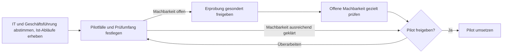

# Roadmap und Einführung

**Status:** Interner Arbeitsentwurf · keine Termin-, Budget- oder Personalzusage.

Die [Pilotkonkretisierung](05_PILOTKONKRETISIERUNG.md) trennt fachlich benannte Tätigkeiten und bestehende mobile Praxis der Baubetreuung von Ablaufvorschlägen und offenen Fragen. Die Auswahl und Abnahme der ersten Pilotabläufe stehen aus.

## Vorgehensprinzip

Gemeinsame, schlanke GDI-Basis und zwei früh beteiligte Pilotbereiche ([A34](04_ENTSCHEIDUNGEN.md#a34)). Der [MVP](ANHANG_A_GLOSSAR.md#mvp) ist priorisiert und anpassbar; gemeinsamer GDI-MVP und fachliche Pilot-MVPs werden getrennt geplant ([A35](04_ENTSCHEIDUNGEN.md#a35)). Phasen dürfen sich überlappen.

### Ablauf bis zur belastbaren Pilotentscheidung

Aktuell laufen Vorbereitung und Abstimmung. IT klärt den Betriebsrahmen, die Geschäftsführung entscheidet über Ressourcen für die Vorbereitung. Praktische Erprobung folgt nach gesonderter Freigabe. Über Umfang, Budget und Start der Piloten entscheidet die Geschäftsführung anhand der Ergebnisse und des mit IT geklärten Betriebsrahmens. Siehe [Mindestabnahme für den Betrieb](BRIEFING_IT.md#mindestabnahme-vor-produktivem-pilot) und [Folgeentscheidung der Geschäftsführung](BRIEFING_GESCHAEFTSFUEHRUNG.md#folgeentscheidung).

## Etappen

### 0 – Vorbereitung und Bestandsaufnahme
- IT, GIS-Team und Pilotbereiche abstimmen; Zuständigkeiten skizzieren.
- Bestehende [QGIS](ANHANG_A_GLOSSAR.md#qgis)-Projekte, Datenquellen, Speicherorte und kritische Abläufe erfassen.
- Problematische synchronisierte [SharePoint](ANHANG_A_GLOSSAR.md#sharepoint)-/[OneDrive](ANHANG_A_GLOSSAR.md#onedrive)-GIS-Arbeitsdatenhaltung in der Baubetreuung identifizieren.
- Konkrete Pilot-Use-Cases und Minimalerfolgskriterien festlegen.
- Wissens- und Schulungsbedarf samt Kapazitäten einplanen ([A33](04_ENTSCHEIDUNGEN.md#a33)).

### 1 – Gemeinsame technische Basis
- [PostGIS](ANHANG_A_GLOSSAR.md#postgis) und QGIS-Desktop-Anbindung; geeignete gemeinsame Datenmodelle.
- TEST/PROD, Grundrechte, Sicherung und Basisüberwachung mit IT abstimmen.
- [Git](ANHANG_A_GLOSSAR.md#git)-basierte Ressourcen und kontrollierte Änderungen etablieren.

### 2 – Erste nutzbare Pilotfunktionen
- **BB:** ausgewählte räumliche Arbeitsabläufe und, wo erforderlich, mobile Nutzung.
- Einfache Karten über den geprüften Standard-Webviewer bereitstellen, sofern der ausgewählte Ablauf sie braucht.
- **Verkehrsanlagenplanung:** gemeinsame Geodaten, Projektbezug und QGIS-Workflows.
- Fachliche Abnahme an realen Daten; keine Pflicht zu gleichem Funktionsumfang.

### 3 – Stabilisierung und kontrollierte Migration
- OneDrive-/SharePoint-basierte führende GIS-Arbeitsbestände der BB nach [A36](04_ENTSCHEIDUNGEN.md#a36) kontrolliert ablösen.
- Datenquellen, Mehrbenutzerbearbeitung, Datenhoheit und Berechtigungen testen.
- Betriebs-, Schulungs- und Supportaufwand aus der Praxis erfassen.

### 4 – Review und Ausbau
- Nutzen, Bedienbarkeit, Datenqualität, Wartbarkeit, Ressourcen und Akzeptanz bewerten.
- Architektur bei Bedarf korrigieren, offene Entscheidungen gezielt bearbeiten.
- Weitere Fachbereiche und Komfortfunktionen nur nach nachgewiesenem Nutzen aufnehmen.

## MVP-Abgrenzung

**Muss für den ersten nutzbaren Stand:** ein konkreter QGIS-Desktop-Ablauf mit geeigneten gemeinsamen Geodaten in PostGIS, wirksamen Rechten und nachgewiesener Wiederherstellbarkeit.

**Je nach Pilot:** Webviewer, mobile Erfassung, Suche, Datenexport, spezifische Datenmodelle.

**Nicht pauschal MVP:** vollständiger Extract-Service, alle Fachbereiche, komplexe CI/CD- oder HA-Plattform, umfassende Datenfreigabeworkflows.

## Prüfpunkte

- Funktionieren Kernabläufe mit echten Nutzern?
- Sind die Datenstände eindeutig und die Rechte wirksam?
- Ist der Betrieb mit verfügbaren IT-/GIS-Ressourcen realistisch?
- Werden zentrale Komponenten tatsächlich in beiden Piloten sinnvoll wiederverwendet?

Keine starren Termine oder Kosten ohne gesicherte Ressourcen- und Aufwandsschätzung.
