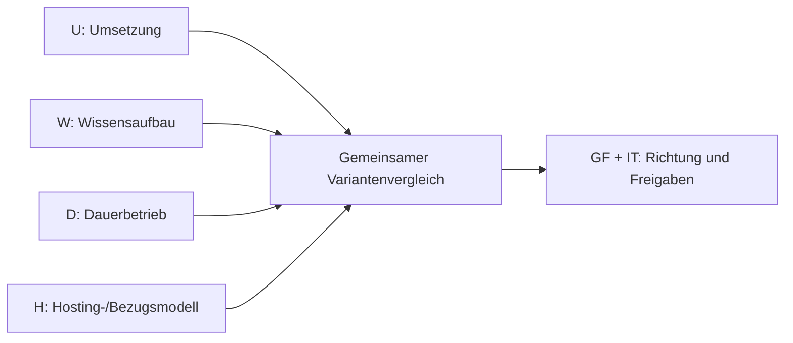

# Umsetzungs-, Qualifizierungs-, Betriebs- und Hostingmodelle – VIC-GDI

**Status:** Vergleich dokumentierter **Prüfoptionen** · **Modellentscheidung [A39](04_ENTSCHEIDUNGEN.md#a39) offen** · Stand: 05.11.2026.  
**Entscheidungszuständigkeit:** Geschäftsführung (GF) und IT gemeinsam in ihrer jeweiligen Verantwortung; GIS-Team und betroffene Fachbereiche liefern Anforderungen und fachliche Bewertung. **Keine Beauftragung, Budgetzusage oder Festlegung eines Dienstleisters.**

**Die GDI wird aus fachlichen Gründen vom GIS-Team und beteiligten Kollegen angestrebt.** Dieses Dokument prüft **nicht ihre grundsätzliche Sinnhaftigkeit**, sondern bewertet, **durch wen und auf welchem Weg** die [GDI](ANHANG_A_GLOSSAR.md#gdi) aufgebaut und später betrieben werden soll. Es ergänzt die bereits geltenden Grundsätze zu [Betriebsverantwortung (A31)](04_ENTSCHEIDUNGEN.md#a31), [Support (A32)](04_ENTSCHEIDUNGEN.md#a32) und [Wissensaufbau (A33)](04_ENTSCHEIDUNGEN.md#a33). Die konkreten Zuständigkeiten für PostgreSQL, GIS-Dienste und Betrieb sind weiterhin offen. Es handelt sich **nicht** um eine Software-, [Deployment- (A24)](04_ENTSCHEIDUNGEN.md#a24) oder Personalentscheidung.

## 1. Vier getrennte Entscheidungsdimensionen

| Dimension | Entscheidungsfrage | Grundsatz |
|---|---|---|
| **U – Umsetzung** | Wer plant, integriert, installiert, konfiguriert und nimmt die GDI technisch in Betrieb? | Intern, gemeinsam oder extern; je Komponente unterschiedlich möglich. |
| **W – Wissensaufbau** | Wie werden erforderliche Fähigkeiten erworben und gesichert? | Selbststudium, Schulung, angeleitete Praxis, Beratung und Wissenstransfer kombinierbar. |
| **D – Dauerbetrieb** | Wer betreut die **VIC-verantworteten** Komponenten nach Inbetriebnahme, einschließlich Updates, Fehleranalyse, Backups und Support? | Intern, unterstützt oder extern; konkrete Schicht-/Dienstgrenzen vereinbaren. |
| **H – Hosting- und Bezugsmodell** | **Wo und in welcher Leistungsform** wird die GDI bereitgestellt? | H1–H4: eigene Infrastruktur, gemietete Infrastruktur, betreute Mietinfrastruktur oder GDI-Plattformservice. |

**Wichtig zur Abgrenzung:** U beschreibt die *Erstimplementierung*, W den *Wissensaufbau*, D den *Betrieb der VIC-verantworteten Schichten* und H das *Hosting-/Bezugsangebot*. **H2/H3 unterscheiden das bezogene Infrastruktur-Leistungspaket**, das je nach Vertrag Betriebsanteile enthält. **D1–D3 bestimmen zusätzlich, wer die übrigen Systeme und GIS-Dienste tatsächlich betreut.** Damit werden Zuständigkeiten **nicht doppelt vergeben oder automatisch aus einem H-Modell abgeleitet**. Bei H4 betreibt der Anbieter die vertraglich gebuchte GDI-Plattform; für VIC verbleibende Integrations- und Fachkomponenten werden separat zugewiesen.

Die Dimensionen gemeinsam bewerten, **keine mathematische Pflicht zu allen 4 × n Kombinationen**: Nur technisch und organisatorisch sinnvolle, tatsächlich anbietbare Kombinationen aufnehmen.

**[A23](04_ENTSCHEIDUNGEN.md#a23) bevorzugt weiterhin On-prem/Proxmox (H1).** Gemietete Infrastruktur und GDIaaS werden als **Alternativen für eine spätere bewusste Abwägung** aufgenommen, nicht als geänderter Beschluss. **[A24](04_ENTSCHEIDUNGEN.md#a24)** behandelt unabhängig davon die technische Bereitstellung (native Dienste, Hybrid, Container); diese ist für H1–H3 zu entscheiden und bei H4 nur für die von VIC selbst betriebenen Komponenten relevant.

### H1–H4 – Hosting- und Bezugsmodelle im Detail

| Option | Leistungsform | Typische Verantwortung | Vorteile | Nachteile / Prüfbedarf |
|---|---|---|---|---|
| **H1 – Eigene Infrastruktur (On-prem)** | Vorhandene/ergänzte VIC-Server und Virtualisierung, z. B. Proxmox | VIC-IT oder beauftragter Dienstleister betreibt Infrastruktur und GDI je D-Modell | Kontrolle, Nähe zu internen Daten, bestehende Infrastruktur nutzbar | Kapazität, Hardware-/Ersatzinvestition, Standort-/Ausfallvorsorge und Betriebspersonal |
| **H2 – Gemietete Infrastruktur (IaaS, kundenseitig administriert)** | Cloud-VM/VPS oder dedizierter Miet-/Root-Server; **eigene VIC-GDI** und volle Konfigurationshoheit | Hoster: physische Infrastruktur/vertraglich definierte Plattform; VIC bzw. gezielt beauftragte Partner: Gast-OS, DB, GIS-Dienste und Absicherung | Keine eigene Serveranschaffung, flexible Dimensionierung, eigener Open-Source-Stack, grundsätzlich migrierbar | Wiederkehrende Miet-/Transferkosten, Netz/Latenz, sicherer Betriebsweg und **weiterhin erheblicher eigener Administrationsaufwand** |
| **H3 – Gemietete, betreute Infrastruktur (Managed IaaS/Hosting)** | Gemietete Rechen-/Speicherressourcen mit **zusätzlich vereinbarter** Administration (z. B. OS und ggf. DB/Backup) | Hoster bzw. Spezialdienstleister betreut **nur die konkret vertraglich vereinbarten Schichten**; GIS-Fachbetrieb ggf. weiterhin VIC/Dienstleister | Entlastung bei Systembetrieb ohne vollständige Bindung an einen GIS-Plattformservice | Leistungen variieren stark; OS-, PostgreSQL-, GIS-, Backup-, Restore- und Sicherheitspflichten einzeln abgrenzen; Schnittstellen-/Dienstleisterkosten |
| **H4 – GDI as a Service (GDIaaS)** | Vom Anbieter gehostete und betriebene **GIS-/GDI-Plattform als Service**, keine selbst verwaltete vollständige Serverinstanz | Anbieter betreibt gebuchten Plattformumfang; VIC bleibt fachlich verantwortlich, übernimmt lokale Integrationen und Vertragssteuerung | Weniger eigene Serveradministration, schnellerer Einstieg bei passendem Angebot, vereinbarbare Serviceleistungen | Abdeckung von Desktop-QGIS/PostGIS, Rechte/SSO/VPN, Daten-/Konfigurationsportabilität, anbieterabhängige Funktionen und variable Serviceentgelte |

**H2 – eigenständig aufgebaute GDI auf gemietetem Server:** Der bisher nicht ausdrücklich dargestellte Fall ist **fachlich und technisch plausibel**: PostGIS, QGIS Server, Viewer, Git-Ressourcen und gegebenenfalls weitere Dienste werden auf angemieteter VM oder dediziertem Server von VIC mit optionaler fachlicher Unterstützung eingerichtet. **Die Miete ersetzt weder Systemadministration noch Datenbank-Backup, Sicherheitsupdates, Monitoring oder Restore-Tests.** Der genaue Umfang hängt vom Infrastrukturvertrag ab (siehe [Shared-Responsibility-Modell bei IaaS](https://aws.amazon.com/de/compliance/shared-responsibility-model/); Beispiel für Verantwortungsabgrenzung, keine Anbieterempfehlung).

**H3 – Anbieterbetreuung statt bloßer Servermiete:** „Managed“ darf **nicht** mit einem automatischen Rundum-GDI-Betrieb verwechselt werden. Ob z. B. PostgreSQL-Updates, Sicherungen, QGIS-Server-Konfiguration und Störungsdiagnose eingeschlossen sind, muss ausdrücklich vereinbart und getestet werden. Der D-Status bildet ab, wer die **verbleibenden** technischen Aufgaben trägt.

**H4 – bisherige Bezeichnung C3/GDIaaS (Umklassifizierung vom 05.11.2026):** Das bisher als **C3** bezeichnete Serviceangebot wird **ohne inhaltliche Streichung** in **H4** überführt, weil es ein **Bezugs-/Hostingmodell** und keine Ausprägung von „Wer implementiert?“ ist. Ein Anbieter stellt eine gehostete, technisch betriebene GDI mit vereinbarten Funktionen bereit (z. B. Geodatenhaltung, OGC-Dienste, Webkarten); tatsächliche Fachfunktionen und interne Administrierbarkeit unterscheiden sich nach Angebot. Nicht jeder gehostete Webviewer erfüllt die Anforderungen an eine gemeinsame GDI.
- **Vorteile:** Keine eigene Installation/Wartung der gebuchten Plattformkomponenten, gegebenenfalls schnell nutzbare Standardfunktionen und vertraglich geregelter Support.
- **Nachteile:** Anbieter-/Leistungsabhängigkeit, mögliche Nutzer-/Speicher-/Transaktions-/Datentransferentgelte sowie Einschränkungen für eigene Datenmodelle, QGIS-Projekte, Datenbankzugriff und Exit.
- **Beispiel des Serviceprinzips, keine Produktempfehlung:** [QGIS Cloud](https://docs.qgiscloud.com/de/); Vollständigkeit, Eignung und kommerzielle Konditionen für VIC sind **nicht belegt** und separat zu prüfen.

**Kombinationen / Grenzen:** H1, H2 und H3 können grundsätzlich mit A1–A3/B1/C1–C2 sowie D1–D3 kombiniert werden, soweit Aufgaben sauber verteilt sind. H4 enthält den Anbieterbetrieb **seines Plattformumfangs** zwingend; das verbleibende D-Modell bezieht sich dann z. B. auf lokale Integrationen, Identität, Datenpflege und technischen Kundensupport. **Nicht alle Kombinationen sind fachlich sinnvoll**; es wird keine vollständige Kombinationsmatrix erzwungen.

**Unterscheidung:** Auch vollständig extern umgesetzte oder betriebene Systeme brauchen interne fachliche Verantwortung, Vertrags-/Dienstleistersteuerung, Zugangskontrolle, Entscheidungsfähigkeit und eine hinreichende Vertretungsregelung. Umgekehrt ist **intern** nicht gleichbedeutend mit **ohne Kosten**: Arbeitszeit, Weiterbildung, laufende Wartung und Kapazitätsreserve gehören in die Betrachtung.

## 2. Umsetzungsmodelle – alle Optionen offen

### A – Überwiegend interne Umsetzung

**A1 – Eigenständig mit überwiegendem Selbststudium**  
Interne GIS- und IT-Mitarbeiter erarbeiten sich fehlendes Wissen selbst und setzen die Lösung um.
- **Vorteile:** Geringe externe Ausgaben; Architektur und Umsetzung intern nachvollziehbar; großer Praxisbezug.
- **Nachteile:** Hoher interner Zeitbedarf; längere Fehlersuche; erhöhte Gefahr von Lücken bei Security, Backups und Produktionsbetrieb, sofern diese Kompetenzen fehlen.
- **Einordnung:** Für abgegrenzte, unkritische Übungen oder PoCs plausibel; für eine vollständige produktive Umsetzung nur bei ausreichend nachgewiesenen Vorkenntnissen und Kapazitäten.

**A2 – Eigenständig mit gezielten Schulungen**  
Das interne Team führt die Implementierung aus; relevante Fach- und Betriebskenntnisse werden durch Schulungen ergänzt.
- **Vorteile:** Planbarer, rollenbezogener Kompetenzaufbau; Wissen bleibt im Haus; geringe Dienstleisterbindung.
- **Nachteile:** Schulung ersetzt keine Erfahrung mit realen Integrations-, Migrations- und Störungsfällen; Umsetzung bleibt zeitintensiv.
- **Einordnung:** Sinnvoll, wenn ausreichend interne Umsetzungskapazität besteht und die Schulungsangebote zum tatsächlichen Stack passen.

**A3 – Eigenständig mit Schulungen und externer Fachberatung**  
Interne Mitarbeiter setzen selbst um; externe Experten beraten punktuell und prüfen kritische Entwürfe, Sicherheits- und Betriebsfragen.
- **Vorteile:** Verantwortung und Praxiswissen bleiben intern; frühe Architektur-/Security-Reviews reduzieren vermeidbare Fehler; externe Leistungen sind begrenzbar.
- **Nachteile:** Hohe interne Kapazitätsbindung; Beratungsqualität und rechtzeitige Verfügbarkeit müssen gesichert sein.
- **Einordnung:** **Vorläufig bevorzugte Möglichkeit**, wenn GIS und IT die Durchführung selbst leisten können.

### B – Kooperative Umsetzung

**B1 – Gemeinsame Implementierung (Co-Implementation)**  
GIS-Team, IT und ein Dienstleister teilen konkrete Implementierungsaufgaben: z. B. interne Fach-/Datenmodelle und Pilotfälle, externe Unterstützung bei Serverintegration oder anspruchsvollen Komponenten. Arbeitsergebnisse werden gemeinsam dokumentiert und abgenommen.
- **Vorteile:** Expertenwissen trifft auf reale VIC-Anforderungen; Wissenstransfer im laufenden Aufbau; Engpässe und komplexe Integrationen lassen sich gezielt abfedern.
- **Nachteile:** Mehr Koordination und Schnittstellen; Wissenstransfer kann ausfallen, wenn der Dienstleister wichtige Komponenten isoliert entwickelt.
- **Einordnung:** **Vorläufig bevorzugte Alternative** zu A3, wenn spezifische Implementierungs- oder Kapazitätslücken bestehen.

### C – Überwiegend externe Umsetzung

**C1 – Externe Komplettumsetzung mit geregelter Übergabe**  
Ein Dienstleister realisiert den vereinbarten Umfang. GIS/IT definieren Anforderungen, prüfen Arbeitsergebnisse und übernehmen anschließend den Betrieb selbst oder mit Support.
- **Vorteile:** Interne Implementierungsbelastung geringer; spezialisierte Erfahrung und mögliche Zeitvorteile.
- **Nachteile:** Höhere externe Aufwendungen; Abhängigkeit während der Erstellung; Betriebsfähigkeit nach Übergabe **nicht automatisch** gegeben.
- **Einordnung:** Tragfähig, wenn interne Implementierungskapazität fehlt, **nur mit überprüfbarer Qualifizierung, Dokumentation und Betriebsübergabe**.

**C2 – Externe Komplettumsetzung einschließlich längerfristigem Betrieb**  
Der Dienstleister realisiert den vereinbarten Umfang und übernimmt außerdem wesentliche technische Betriebsleistungen. Die Infrastruktur **kann dabei im Unternehmen verbleiben** (z. B. auf betreuten VIC-VMs); auch andere Betriebsorte wären vertraglich möglich.
- **Vorteile:** Geringerer eigener Technik-/Betriebsaufwand; vereinbarbare Serviceleistungen und Reaktionszeiten.
- **Nachteile:** Laufende Kosten und mögliche Anbieterbindung; Vertrags-/Sicherheitssteuerung sowie interne Daten- und Fachverantwortung bleiben erforderlich.
- **Einordnung:** Alternative bei dauerhaft begrenzter IT-/GIS-Betriebskapazität. **Nicht mit vollständiger Abgabe von Kontrolle oder Verantwortung verwechseln.**

**Abgrenzung der C-Modelle:** C1 = extern umsetzen und übergeben; C2 = externe Umsetzung **mit gebündeltem, längerfristigem Betriebspaket**. C2 ist eine angebotstypische Kopplung von **U + D**, keine eigene Hostingart. **GDIaaS wurde von C3 nach H4 umklassifiziert** (Begründung unter [H1–H4](#h1h4--hosting--und-bezugsmodelle-im-detail)). Für die laufende Betriebszuständigkeit ist D1–D3 maßgeblich.

## 3. Orientierende Vergleichsmatrix

Die Einschätzungen sind **qualitativ und vorläufig** – keine Angebote, Zeitkalkulationen oder belastbaren Preisvergleiche. Je nach vorhandenem Know-how, Personalressourcen, Infrastruktur und vertraglichem Umfang können sie anders ausfallen.

| Kriterium | A1 | A2 | A3 | B1 | C1 | C2 |
|---|---|---|---|---|---|---|
| Externer Aufbauaufwand | sehr gering | Schulungen | Schulung + Beratung | geteilte Leistungen | vollständige Beauftragung | Aufbau + Betriebspaket |
| Interne Aufbaukapazität | sehr hoch | hoch | hoch | mittel–hoch | geringer, aber Abnahme nötig | geringer, aber Steuerung nötig |
| Wissensaufbau | überwiegend Eigenlernen | Schulung + Praxis | Schulung + Beratung + Praxis | gemeinsame Praxis | vertraglicher Transfer nötig | Steuerungs-/Notfallwissen nötig |
| Spezialkompetenz beim Aufbau | intern nötig | Schulung + Praxis | externe Reviews möglich | Spezialisten eingebunden | Dienstleister trägt Umsetzung | Dienstleister trägt Umsetzung |
| Dienstleisterabhängigkeit | gering | gering | gering–mittel | mittel | abhängig von Übergabe | tendenziell höher |
| Dauerbetrieb automatisch geregelt? | **nein** | **nein** | **nein** | **nein** | **nein** | nur gebuchter Vertragsumfang |

### Hostingvergleich H1–H4 – unabhängig vom Umsetzungsteam

| Kriterium | H1: On-prem | H2: gemietete Infrastruktur | H3: betreute Mietinfrastruktur | H4: GDIaaS |
|---|---|---|---|---|
| Eigener GDI-Stack / Konfiguration | Vollständig gestaltbar | Vollständig gestaltbar | Nach Adminrechten/Vertrag | Vom Plattformangebot abhängig |
| Hardware / Virtualisierung | VIC bzw. vorhandene IT | Infrastrukturhoster | Infrastrukturhoster | Plattformanbieter |
| Gast-OS und GIS-Dienste | VIC/Partner gemäß D | VIC/Partner gemäß D | Schichtweise laut Vertrag | Plattformanbieter nur im gebuchten Umfang |
| Eigene Serveranschaffung | ggf. | nein | nein | nein |
| Externe laufende Kosten | ggf. Support/Hardware | Miete, Speicher, Traffic, ggf. Support | Miete + vereinbarte Managementleistungen | Plattform-/Nutzer-/Speicher-/Traffic-Gebühren, ggf. Zusatzleistungen |
| Netzpfade/Performance | Gute lokale Anbindung möglich | Standortkopplung, VPN, Latenz, Transferkosten prüfen | ebenso | Von Dienstschnittstellen und Netzpfad abhängig |
| Portabilität | Intern planbar | VM/Daten/Konfiguration grundsätzlich migrierbar; Exit prüfen | wie H2, mit Übergaberechten | Plattform-/Datenmodell-/Projektportabilität explizit nachweisen |
| Hauptprüffrage | Genügen Ressourcen und Betriebskapazität? | Wer administriert dauerhaft OS, PostGIS und GIS-Dienste? | Was betreut der Anbieter wirklich? | Deckt der Service die fachlichen GDI-Anforderungen ab? |

### Repräsentative Kombinationen statt Modellverwechslung

| Fachlich denkbare Variante | Umsetzung (U) | Betrieb (D) | Hosting (H) |
|---|---|---|---|
| Eigene GDI auf bestehender Infrastruktur | A3 oder B1 | D1/D2 | H1 |
| **Eigene GDI auf gemieteter VM/Root-Server** | **A3 oder B1** | **D1/D2** | **H2** |
| Eigene GDI auf betreuter Mietinfrastruktur | A3 oder B1 | D2/D3 (nach Leistungsgrenze) | H3 |
| Extern realisierte und betreute GDI | C2 | D3 (Vertragsumfang) | H1/H2/H3 je Vereinbarung |
| GDI-Plattform als Dienst | Anbieter-Onboarding/Integration; **kein eigenes C-Implementierungsmodell erforderlich** | Anbieter betreibt Plattform; VIC regelt Restaufgaben | H4 |

**Hinweis:** Die Darstellung ist **kein** Kosten- oder Sicherheitsranking. Hoster und interne IT müssen Verantwortlichkeiten von Hardware/Hypervisor über Gast-OS, PostgreSQL, GIS-Dienste, Authentifizierung und Backup bis zum Restore **für jede Variante** benennen. Gemietete Infrastruktur ist weder automatisch günstiger noch automatisch leichter zu betreiben als vorhandene VIC-/Proxmox-Ressourcen. In H2/H3 sind verlässliche Verbindungen zu QGIS-Desktop-Arbeitsplätzen und lokalen CAD-/GIS-Fachdaten besonders wichtig.

Eine scheinbar günstige Variante kann durch interne Ausfallzeiten oder späteren Supportaufwand teurer werden. **Nicht nur Anschaffungspreise vergleichen**: einmalige externe Leistungen, interne Personentage, Schulung und Wissenspflege, Infrastrukturmiete oder Hardwarebedarf, Backups, Updates, Support, Netzwerkkosten und spätere Anbieterwechsel gehören in den Kostenrahmen.

## 4. Betrieb und Wartung – separat zu wählen

| Modell | Verantwortungsumfang | Vorteil | Nachteil / Mindestvoraussetzung |
|---|---|---|---|
| **D1 – Überwiegend intern** | IT und GIS betreiben ihre zugewiesenen Komponenten; externe Hilfe nur bei Bedarf. | Unabhängigkeit, kurze interne Abstimmung. | Ausreichende Kapazität, Wissen, Vertretung und Störfallverfahren erforderlich. |
| **D2 – Intern mit externem Spezialistensupport** | Regelbetrieb intern; externe Hilfe für schwierige Störungen, größere Updates, Spezialthemen. | Kombination aus Kontrolle und gezielter Expertise. | Supportumfang, Erreichbarkeit und Schnittstellen vereinbaren. |
| **D3 – Überwiegend extern betreut** | Vertraglich definierte technische Betriebsleistungen extern; fachliche Verantwortung, Steuerung und Kontrolle intern. | Technische Entlastung und spezialisierter Support. | Laufende Kosten, Abhängigkeiten, Kontroll- und Übergabebedarf. |

**D1–D3 beschreiben den Betrieb der VIC-verantworteten Komponenten und können mit verschiedenen U- und H-Modellen kombiniert werden.** Bei H4 ist der Anbieterbetrieb der gebuchten Plattform bereits Bestandteil der Leistung; D bleibt für die nicht umfassten Komponenten relevant. Beispiele:

- **A2 + D1 + H1:** Aufbau und Regelbetrieb auf VIC-Infrastruktur intern nach Schulungen.
- **A3 + D2 + H1/H2:** Interner Aufbau mit externer Beratung; Betrieb auf eigenen oder gemieteten, kundenseitig betreuten Servern.
- **B1 + D2 + H2:** Gemeinsamer GDI-Aufbau auf einer gemieteten VM, interner Regelbetrieb mit Spezialistensupport.
- **B1 + D2/D3 + H3:** Gemeinsamer Aufbau auf betreuter Mietinfrastruktur; externe und interne GIS-Aufgaben ausdrücklich abgrenzen.
- **C1 + D1/D2 + H1/H2:** Externe Erstellung mit qualifizierter Übergabe; danach interner/unterstützter Betrieb.
- **C2 + D3 + H1/H2/H3:** Extern realisierte und technisch betreute GDI, Hostingort vertraglich offen.
- **H4:** GDI-Plattformservice mit Anbieterbetrieb; interne GIS-Fachverantwortung und Betreuung verbleibender Systeme ausdrücklich zuweisen.

Weitere Mischungen sind möglich. Das Modell muss **nicht für jede Komponente gleich** sein: GIS-Fachmodelle/QGIS-Ressourcen, Server/Netz/Backup und GIS-Spezialdienste können unterschiedliche Umsetzungs- und Supportanteile erhalten. Die bestehende [Rollenabgrenzung](BRIEFING_IT.md#rollen-und-verantwortlichkeiten-a31) ist der Ausgangspunkt, keine fertige Detailverteilung.

## 5. Wissensaufbau und Mindestkompetenzen

Die nach [A33](04_ENTSCHEIDUNGEN.md#a33) notwendige Qualifizierung ist ein **eigenständiger Ressourcenposten**, unabhängig davon, wer die Erstimplementierung ausführt.

| Weg | Geeigneter Einsatz | Kritischer Punkt |
|---|---|---|
| Selbststudium / Labor | Einführung, Teilaufgaben, gezielte Erprobung | Zeit einplanen, Ergebnisse intern dokumentieren. |
| Gezielte Schulung | Rollenbezogene DB-, Server-, Linux-, QGIS- oder Sicherheitskenntnisse | Praxistransfer am realen GDI-Aufbau nachweisen. |
| Beratung / Architekturreview | Einzelne schwierige technische und betriebliche Entscheidungen | Konkreten Liefergegenstand und Review-Ergebnis vereinbaren. |
| Co-Implementation / Mentoring | Umsetzung kritischer Komponenten mit direktem Wissenstransfer | Interne Mitarbeiter müssen aktiv mitarbeiten, nicht nur zusehen. |
| Betriebsübergabe / Notfallübung | Insbesondere C1/C2, H3/H4 und Wechsel von Dienstleistern | Intern Wiederanlauf, Updateweg und Eskalation tatsächlich nachvollziehen. |

**Mindestwissen trotz externer Leistung:** GIS/Fachbereiche müssen Datenhoheit, fachliche Nutzung und Abnahme steuern können. Die IT muss technische Zugänge, Identitäten, Sicherheitsvorgaben, Dienstleisterzugriff und Betriebs-/Notfallverantwortung beurteilen können. Für extern betreute Systeme ist nicht jede Implementierungsfertigkeit intern nötig, wohl aber ausreichende **Steuerungs-, Prüf- und Exit-Fähigkeit**.

## 6. Externe Leistungen: Mindestanforderungen und Übergabe

Bei **A3 (Beratungsanteil), B1, C1/C2 sowie H2–H4 je Vertragsanteil** ist der jeweilige Leistungsumfang klar abzugrenzen; für vollständige externe Umsetzungen bzw. extern gehostete Dienste sind besonders zu regeln:

- **Lieferumfang und Akzeptanz:** Versions-/Komponentenliste, Konfigurationen, Datenmodelle, Skripte, Migrations-/Installationsanleitung, technische Schnittstellen; definierte Tests und dokumentierte Mängelbehebung.
- **Sicherheit und Datenhoheit:** Betriebs- und Administrationszugänge unter Unternehmenskontrolle, Berechtigungskonzept, geregelte externe Zugriffe, Datenschutz-/Vertraulichkeitsvorgaben; keine unkontrollierten Fremdzugriffe.
- **Betrieb:** Update-/Rollback-Anleitung, Monitoring, Datensicherung, **nachgewiesener Restore**, Incident-/Supportwege und Zuständigkeiten je Komponente.
- **Wissenstransfer:** Rollenbezogene Einweisung **plus praktische Demonstration** durch internes Personal; Vertretung und Dokumentationspflege.
- **Abhängigkeiten und Rechte:** Nutzungs- und Änderungsrechte an individualisierten Skripten/Konfigurationen, Zugang zu Quelltexten/Artefakten, Fremdkomponenten und Lizenzen, geeignete Exit-/Dienstleisterwechsel-Regelungen.
- **Serviceleistungen bei D2/D3:** Unterstützung, Verfügbarkeit, Reaktions- und Wiederherstellungswege, Eskalation, Kostenmodell, Laufzeit und Übergabepflichten vereinbaren.
- **Zusätzlich für GDIaaS (H4) verbindlich prüfen:** Abdeckung der **VIC-GDI-Kernanforderungen**, insbesondere editierbarer zentraler Geodatenbestand, fachliche Datenhoheit, QGIS-Desktop-/PostGIS-Zugriff (falls erforderlich), WMS/WFS bzw. benötigte OGC-APIs, Webviewer, Projekt-/Stilkonfigurationen, AD/Entra/SSO, Rollen-/Exportrechte, Zugriff registrierter Geräte über freigegebene Netze/VPN und Anbindung verbleibender lokaler Daten.
- **Datenstandort und Datenschutz:** Hostingstandort und Unterauftragnehmer, Auftragsverarbeitung **bei entsprechender Verarbeitung personenbezogener Daten**, Zugriffskontrolle, Verschlüsselung, Protokollierung, Datensicherung/Wiederherstellung und Verfügbarkeit vertraglich und technisch beurteilen; EU-Hosting allein ersetzt keine Datenschutzprüfung ([EU-Kommission: Verantwortliche/Auftragsverarbeiter](https://commission.europa.eu/law/law-topic/data-protection/information-business-and-organisations/application-gdpr_en)).
- **H2/H3: Infrastrukturvertrag und Verantwortungsmatrix:** Region/Standort, öffentliche und private Netze, Netzwerk- und Datentransferentgelte, Firewall, Verschlüsselung, Patchen des Gast-OS, PostgreSQL-/GIS-Dienstbetrieb, Dateispeicher, Backup/Restore, Monitoring und Reaktionszeiten ausdrücklich zuordnen. Mietserver, private Netze oder Provider-Backups sind **keine** automatische End-to-End-GDI-Betriebsleistung. Quelle für das IaaS-Prinzip: [Shared Responsibility](https://aws.amazon.com/de/compliance/shared-responsibility-model/) (keine Produktempfehlung).
- **Exit- und Wechseltest:** Vollständige, dokumentierte Herausgabe von Geodaten **inklusive Schema, Attributen, CRS, Rollen-/Rechtezuordnung soweit exportierbar, QGIS-Projekten/Stilen, Metadaten und relevanten Konfigurationen**; erforderliche Nutzungsrechte und Löschbestätigung, Aufwand und Kosten der Rückmigration, realistischer Anbieterwechsel. Bei H2/H3 zusätzlich VM-/Betriebsumgebungswechsel, bei H4 insbesondere Plattformwechsel berücksichtigen. OGC-Dienste allein gewährleisten **keine** vollständige Datenbank-/Projektportabilität.

**Keine eigenen umfangreichen Service-Management-Prozesse erfinden:** vorhandene IT-Verfahren nutzen ([A32](04_ENTSCHEIDUNGEN.md#a32)). Open Source senkt Softwarelizenzkosten, garantiert aber weder kostenlose externe Leistungen noch einen betreibbaren Betrieb.

## Kostenrahmen und Lizenzabgrenzung

**Softwarelizenzen sind nicht die Gesamtkosten.** Für die im Konzept vorgesehenen freien GDI-Kernkomponenten fallen grundsätzlich keine zusätzlichen Softwarelizenz-/Nutzergebühren an (Software- und Quellenübersicht: [software/README](software/README.md#lizenz--und-kostenüberblick-gdi-kern)). Kosten für Implementierung, Qualifizierung, Betrieb, externe Leistungen und gegebenenfalls zusätzliche Infrastruktur sind davon getrennt.

| Kostenfeld | Bei der A39-Bewertung berücksichtigen |
|---|---|
| **Einmalige Eigenleistung** | Bestandsaufnahme, Konzeption, Installation, Datenmodelle, Migration, Tests, Einführung und Dokumentation; reale interne Personentage. |
| **Qualifizierung** | Einarbeitung, Schulung, gemeinsame Praxis, Wissenstransfer und Vertretungsfähigkeit; nicht als kostenlose Nebenaufgabe behandeln. |
| **Laufender Betrieb** | Administration, Fachpflege, Sicherheitsupdates, Monitoring, Backups/Restore-Tests, Support und Weiterentwicklung. |
| **Infrastruktur (offen)** | Vorhandene CPU-/RAM-/Speicher-/Backup-Reserven bzw. Kosten gemieteter CPU-/RAM-/Speicher-/Backup-Ressourcen, Netzverbindungen, Datentransfer und ggf. zusätzliche Hardware; **Bedarf und Kosten nur nach IT-Prüfung**. |
| **Externe/optionale Leistungen** | Beratung, Implementierung, Supportverträge, **H2/H3-Infrastrukturmiete und ggf. Managed-Hosting-Entgelte**, **H4-GDIaaS-Einrichtung und Plattform-/Nutzer-/Speicher-/Transaktionsentgelte** (vertragsabhängig), optionale Proxmox-Subskription, gehostete QFieldCloud und kommerzielle Zusatzdienste. Kostenarten ohne Doppelzählung zu Infrastruktur erfassen. |
| **Daten und Bestandssoftware** | Rechte und Gebühren für externe Geodaten/Karten/APIs; mögliche Kapazitäts- und Vertragsfolgen bestehender Unternehmenssoftware. |

**Wirtschaftlichkeitsprüfung:** Für zwei bis drei realistische **U/W/D/H-Kombinationen** – **H1 mit vorhandenen Proxmox-Ressourcen, H2/H3 als Miet-/Managed-Hosting-Angebot und H4 bei fachlich geeignetem Service** ausdrücklich in die Vorauswahl einbeziehen – dieselben Kostenarten und denselben Betrachtungszeitraum (z. B. drei Jahre) zugrunde legen. Nicht jedes H-Modell benötigt gleich viel eigene Infrastruktur oder gleiche Fachimplementierung. Die Vorteile einer gemeinsamen GDI sind die **fachliche Ausgangsposition**; noch nicht gemessene Zeiteinsparungen sind keine bereits realisierten Geldbeträge. Bewertet wird, **welches Umsetzungs- und Betriebsmodell** den gewünschten Mehrwert mit vertretbaren Ressourcen, Risiken und laufenden Verpflichtungen erschließt – nicht, ob zentrale Geodatenorganisation grundsätzlich nützlich ist.

**Abgrenzungen:** QField-App ist kostenlos, gehostete [QFieldCloud](https://qfield.cloud/pricing) kann kostenpflichtig sein; selbst gehosteter Synchronisationsbetrieb verursacht Aufwand ([SW-05](software/05_MOBILER_DATENAUSTAUSCH.md)). Proxmox VE ist ohne Subskription nutzbar, das Enterprise-Repository und Herstellersupport sind optional; vorhandene Infrastruktur/Verträge entscheidet die IT ([IT-Briefing](BRIEFING_IT.md#softwarelizenzen-und-optionaler-herstellersupport)). Docker Engine unter Linux ist nicht Docker Desktop. Die freie Kernsoftware löst keine Lizenzrechte an Dritt-Geodaten.

## 7. Kriterien und Vorgehen für die Entscheidung

### Vorabfragen für GIS, IT und Geschäftsführung

1. **Leistungsumfang:** Was ist tatsächlich Teil des ersten GDI-/Pilot-MVP? Welche technischen Risiken bestehen?
2. **Interne Kapazität:** Wer kann wie viele Personentage übernehmen – mit realistisch freigestellter Zeit, Urlaubs-/Krankheitsvertretung und Zuständigkeit?
3. **Kompetenzlücken:** Welche Aufgaben erfordern Schulung, Beratung oder externe Implementierung? Was muss mindestens intern beherrscht werden?
4. **Betriebsfähigkeit und Hosting:** Welche H1–H4-Angebote erfüllen die Anforderungen, welche Komponenten kann IT betreiben, wo liegen vertragliche Schichtgrenzen, und wie werden Vertretung, 2nd-Level-Support und Anbietersteuerung organisiert?
5. **Wirtschaftlichkeit:** Welche Einmal- und Folgekosten entstehen für jedes realistische Modell über einen **gemeinsamen Betrachtungszeitraum** (z. B. drei Jahre)?
6. **Risiken und Exit:** Wie werden Sicherheit, Anbieterwechsel, Datenhoheit, Wiederherstellung und Dokumentation abgesichert?

### Entscheidungspfad ohne vorweggenommenen Beschluss

1. **GIS + Fachbereiche:** Pilotfälle, fachliche Verantwortlichkeiten und benötigte Funktionen konkretisieren.
2. **IT + GIS:** Kapazitäten, Kompetenzprofil, Verantwortlichkeiten und die tatsächlich kritischen technischen Teilaufgaben erfassen.
3. **Optional gezielter, separat freigegebener PoC:** nur wenn er eine relevante Machbarkeits-/Ressourcenfrage klärt; kein Großprojekt als Vorbedingung.
4. **Vergleich 2–3 realistischer U/W/D/H-Kombinationen:** Leistungen, interne Zeit, Qualifizierungsaufwand, Hosting, Netz-/Transferkosten, Betrieb, Risiken und Exit konsistent gegenüberstellen. **H2 (eigene GDI auf gemieteten Servern), H3 (Managed Hosting) und H4 (GDIaaS)** als Alternativen zu H1 ausdrücklich prüfen; wo fachlich geeignet, reale Leistungsangebote einholen, ohne vorab einen Anbieter zu wählen.
5. **GF und IT entscheiden gemeinsam in ihren Zuständigkeitsbereichen:** GF über Umfang/Budget/Beauftragung, IT über technischen Betriebsrahmen und Übernahmefähigkeit; GIS/Fachbereiche liefern fachliche Bewertung. **Ergebnis und Begründung erst dann im [Entscheidungsregister](04_ENTSCHEIDUNGEN.md) festhalten.**

## 8. Vorläufige fachliche Empfehlung – kein Beschluss

**A3 oder B1 mit D2 und H1** bleibt als Einstieg **prüfenswert**, falls vorhandene Proxmox-Ressourcen und interne GIS-/IT-Kapazitäten ausreichen. **H2 mit derselben eigenen GDI-Architektur** ist eine ernsthafte Alternative ohne eigene Hardwareanschaffung, beseitigt aber **nicht** den Serverbetriebsaufwand. **H3** kann einen Teil davon auslagern; **H4/GDIaaS** ist als fachlich geeigneter Plattformservice zu vergleichen. Keine dieser Optionen wird pauschal bevorzugt, bevor Netz, Datenhoheit, Kosten, Kompetenzen, Backup/Restore und Exit geklärt sind.

Diese Empfehlung gilt **unter Vorbehalt** real verfügbarer GIS-/IT-Personentage, kompetenter interner Ansprechpersonen und ausreichend planbarer Qualifizierung. Bei knappen Kapazitäten oder komplexer Integrationslage können C1/C2, H3 oder H4 wirtschaftlich/organisatorisch sinnvoller sein; H2 benötigt dagegen trotz Hostingmiete ein tragfähiges internes/extern unterstütztes Administrationsmodell. A1 bleibt für kleine Übungen möglich, ist aber **nicht** allein wegen niedriger Rechnungsbeträge zu bevorzugen.

**Offen bis zur Entscheidung durch GF und IT:** konkrete Kombination **U/W/D/H**, Komponentenverteilung, Hostingstandort, Netzwerk-/Sicherheitsanforderungen, Betriebs-/Supportverantwortung, Kapazitätsfreigabe, Kostenrahmen und vertragliche Exit-/Übergaberegeln. **A39 bleibt offen**; [A23](04_ENTSCHEIDUNGEN.md#a23) und [A24](04_ENTSCHEIDUNGEN.md#a24) bleiben unverändert. Kein Modell wird hiermit verbindlich ausgewählt.
