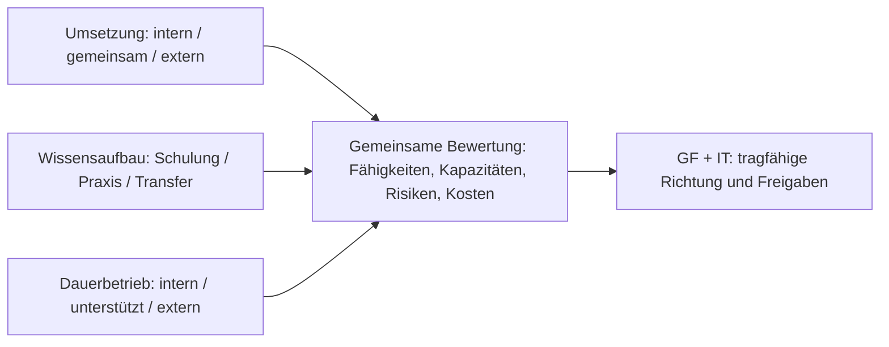

# Umsetzungs-, Qualifizierungs- und Betriebsmodelle – VIC-GDI

**Status:** Vergleich dokumentierter **Prüfoptionen** · **Modellentscheidung [A39](04_ENTSCHEIDUNGEN.md#a39) offen** · Stand: 05.11.2026.  
**Entscheidungszuständigkeit:** Geschäftsführung (GF) und IT gemeinsam in ihrer jeweiligen Verantwortung; GIS-Team und betroffene Fachbereiche liefern Anforderungen und fachliche Bewertung. **Keine Beauftragung, Budgetzusage oder Festlegung eines Dienstleisters.**

**Die GDI wird aus fachlichen Gründen vom GIS-Team und beteiligten Kollegen angestrebt.** Dieses Dokument prüft **nicht ihre grundsätzliche Sinnhaftigkeit**, sondern bewertet, **durch wen und auf welchem Weg** die [GDI](ANHANG_A_GLOSSAR.md#gdi) aufgebaut und später betrieben werden soll. Es ergänzt die bereits geltenden Grundsätze zu [Betriebsverantwortung (A31)](04_ENTSCHEIDUNGEN.md#a31), [Support (A32)](04_ENTSCHEIDUNGEN.md#a32) und [Wissensaufbau (A33)](04_ENTSCHEIDUNGEN.md#a33). Die konkreten Zuständigkeiten für PostgreSQL, GIS-Dienste und Betrieb sind weiterhin offen. Es handelt sich **nicht** um eine Software-, [Deployment- (A24)](04_ENTSCHEIDUNGEN.md#a24) oder Personalentscheidung.

## 1. Drei Entscheidungsdimensionen und ein Bezugsmodell

| Dimension | Entscheidungsfrage | Grundsatz |
|---|---|---|
| **U – Umsetzung** | Wer plant, integriert, installiert, konfiguriert und nimmt die GDI technisch in Betrieb? | Intern, gemeinsam oder extern; je Komponente unterschiedlich möglich. |
| **W – Wissensaufbau** | Wie werden erforderliche Fähigkeiten erworben und gesichert? | Selbststudium, Schulung, angeleitete Praxis, Beratung und Wissenstransfer kombinierbar. |
| **D – Dauerbetrieb** | Wer übernimmt Updates, Fehleranalyse, Support, Sicherung und technische Weiterentwicklung? | Eigenständige Entscheidung – nicht automatisch durch den Umsetzungsauftrag vorgegeben. |

**Zusätzlich zu diesen drei organisatorischen Dimensionen ist zu klären, wo die Infrastruktur bereitgestellt wird und wie sie bezogen wird:** eigene Infrastruktur, extern betreute eigene Infrastruktur oder eine vom Anbieter **gehostete und betriebene GDI als Service**. Letzteres wird als **C3** unten ausdrücklich berücksichtigt. Die Servicebereitstellung ist **nicht dasselbe** wie die allgemeine externe Betriebsunterstützung D3. [A23](04_ENTSCHEIDUNGEN.md#a23) bevorzugt weiterhin On-prem; der Vergleich einer Dienstleistung bedeutet keine Änderung dieser Vorzugsrichtung.

Die organisatorischen Entscheidungen müssen **gemeinsam auf Tragfähigkeit** geprüft werden, dürfen aber unterschiedliche interne und externe Anteile haben:

Das Schema ist eine **Entscheidungshilfe**, keine bereits gewählte Kombination. Die konkrete technische Dienstverteilung, Umsetzungsaufträge und Betriebsübernahme bleiben bis zu den jeweiligen Freigaben offen.

**Unterscheidung:** Auch vollständig extern umgesetzte oder betriebene Systeme brauchen interne fachliche Verantwortung, Vertrags-/Dienstleistersteuerung, Zugangskontrolle, Entscheidungsfähigkeit und eine hinreichende Vertretungsregelung. Umgekehrt ist **intern** nicht gleichbedeutend mit **ohne Kosten**: Arbeitszeit, Weiterbildung, laufende Wartung und Kapazitätsreserve gehören in die Betrachtung.

## 2. Umsetzungsmodelle – alle Optionen offen

### A – Überwiegend interne Umsetzung

**A1 – Eigenständig mit überwiegendem Selbststudium**  
Interne GIS- und IT-Mitarbeiter erarbeiten sich fehlendes Wissen selbst und setzen die Lösung um.
- **Vorteile:** Geringe externe Ausgaben; Architektur und Umsetzung intern nachvollziehbar; großer Praxisbezug.
- **Nachteile:** Hoher interner Zeitbedarf; längere Fehlersuche; erhöhte Gefahr von Lücken bei Security, Backups und Produktionsbetrieb, sofern diese Kompetenzen fehlen.
- **Einordnung:** Für abgegrenzte, unkritische Übungen oder PoCs plausibel; für eine vollständige produktive Umsetzung nur bei ausreichend nachgewiesenen Vorkenntnissen und Kapazitäten.

**A2 – Eigenständig mit gezielten Schulungen**  
Das interne Team führt die Implementierung aus; relevante Fach- und Betriebskenntnisse werden durch Schulungen ergänzt.
- **Vorteile:** Planbarer, rollenbezogener Kompetenzaufbau; Wissen bleibt im Haus; geringe Dienstleisterbindung.
- **Nachteile:** Schulung ersetzt keine Erfahrung mit realen Integrations-, Migrations- und Störungsfällen; Umsetzung bleibt zeitintensiv.
- **Einordnung:** Sinnvoll, wenn ausreichend interne Umsetzungskapazität besteht und die Schulungsangebote zum tatsächlichen Stack passen.

**A3 – Eigenständig mit Schulungen und externer Fachberatung**  
Interne Mitarbeiter setzen selbst um; externe Experten beraten punktuell und prüfen kritische Entwürfe, Sicherheits- und Betriebsfragen.
- **Vorteile:** Verantwortung und Praxiswissen bleiben intern; frühe Architektur-/Security-Reviews reduzieren vermeidbare Fehler; externe Leistungen sind begrenzbar.
- **Nachteile:** Hohe interne Kapazitätsbindung; Beratungsqualität und rechtzeitige Verfügbarkeit müssen gesichert sein.
- **Einordnung:** **Vorläufig bevorzugte Möglichkeit**, wenn GIS und IT die Durchführung selbst leisten können.

### B – Kooperative Umsetzung

**B1 – Gemeinsame Implementierung (Co-Implementation)**  
GIS-Team, IT und ein Dienstleister teilen konkrete Implementierungsaufgaben: z. B. interne Fach-/Datenmodelle und Pilotfälle, externe Unterstützung bei Serverintegration oder anspruchsvollen Komponenten. Arbeitsergebnisse werden gemeinsam dokumentiert und abgenommen.
- **Vorteile:** Expertenwissen trifft auf reale VIC-Anforderungen; Wissenstransfer im laufenden Aufbau; Engpässe und komplexe Integrationen lassen sich gezielt abfedern.
- **Nachteile:** Mehr Koordination und Schnittstellen; Wissenstransfer kann ausfallen, wenn der Dienstleister wichtige Komponenten isoliert entwickelt.
- **Einordnung:** **Vorläufig bevorzugte Alternative** zu A3, wenn spezifische Implementierungs- oder Kapazitätslücken bestehen.

### C – Überwiegend externe Umsetzung

**C1 – Externe Komplettumsetzung mit geregelter Übergabe**  
Ein Dienstleister realisiert den vereinbarten Umfang. GIS/IT definieren Anforderungen, prüfen Arbeitsergebnisse und übernehmen anschließend den Betrieb selbst oder mit Support.
- **Vorteile:** Interne Implementierungsbelastung geringer; spezialisierte Erfahrung und mögliche Zeitvorteile.
- **Nachteile:** Höhere externe Aufwendungen; Abhängigkeit während der Erstellung; Betriebsfähigkeit nach Übergabe **nicht automatisch** gegeben.
- **Einordnung:** Tragfähig, wenn interne Implementierungskapazität fehlt, **nur mit überprüfbarer Qualifizierung, Dokumentation und Betriebsübergabe**.

**C2 – Externe Komplettumsetzung einschließlich längerfristigem Betrieb**  
Der Dienstleister realisiert den vereinbarten Umfang und übernimmt außerdem wesentliche technische Betriebsleistungen. Die Infrastruktur **kann dabei im Unternehmen verbleiben** (z. B. auf betreuten VIC-VMs); auch andere Betriebsorte wären vertraglich möglich.
- **Vorteile:** Geringerer eigener Technik-/Betriebsaufwand; vereinbarbare Serviceleistungen und Reaktionszeiten.
- **Nachteile:** Laufende Kosten und mögliche Anbieterbindung; Vertrags-/Sicherheitssteuerung sowie interne Daten- und Fachverantwortung bleiben erforderlich.
- **Einordnung:** Alternative bei dauerhaft begrenzter IT-/GIS-Betriebskapazität. **Nicht mit vollständiger Abgabe von Kontrolle oder Verantwortung verwechseln.**

**C3 – GDI as a Service (GDIaaS): als Dienstleistung bezogene GDI-Plattform**  
Ein spezialisierter Anbieter stellt eine **bei ihm bzw. in seiner beauftragten Cloud-/Hostingumgebung gehostete und technisch betriebene GDI** mit vertraglich definierten Funktionen bereit, etwa Geodatenhaltung, standardisierte GIS-Dienste und Webkarten; Umfang, Administrationsrechte und Integration können je Angebot stark variieren. Das Unternehmen nutzt und gestaltet die Dienste fachlich, statt deren Serverplattform selbst aufzubauen.
- **Vorteile:** Weniger interne Serverinstallation und -wartung; schneller nutzbare Standardfunktionen möglich; Wartung, Aktualisierung und Verfügbarkeit können als Service vereinbart werden; planbare laufende Entgelte bei passendem Preismodell.
- **Nachteile:** Abhängigkeit von Anbieter, Vertragsumfang und Verbindung; mögliche laufende oder nutzungsabhängige Kosten (Datenvolumen, Nutzer, Speicher, Transaktionen, ausgehender Datentransfer); ggf. eingeschränkte PostGIS-/QGIS-Desktop-Integration, individuelle Konfiguration und Daten-/Projektportabilität.
- **Einordnung:** **Eigenständig und ernsthaft zu prüfende A39-Option**, besonders bei geringer interner Serverbetriebskapazität. **Nicht jeder gehostete Webkarten-Viewer ist eine vollständige GDIaaS:** Vor einem Vergleich muss geprüft werden, ob die tatsächlich benötigte Datenhaltung, QGIS-Arbeit, Identitäten, Fachmodelle und Schnittstellen abgedeckt sind. Fachliche Verantwortung und Datenhoheit bleiben intern.
- **Beispiel für das Serviceprinzip, keine Produktempfehlung:** [QGIS Cloud](https://docs.qgiscloud.com/de/) beschreibt eine extern bereitgestellte QGIS-basierte Infrastruktur. Die Erfüllung der spezifischen VIC-GDI-Anforderungen ist damit **nicht nachgewiesen**; keine konkrete Anbieter- oder Produktentscheidung.

**Abgrenzung A3/B1/C1/C2/C3:** A3 bedeutet **beraten lassen, intern implementieren**; B1 **gemeinsam implementieren**; C1 **extern erstellen, dann übergeben**; C2 **extern erstellen und technisch betreuen**, ggf. weiterhin in VIC-Infrastruktur; C3 **fertige bzw. konfigurierte GDI-Plattform als extern gehosteten und betriebenen Service beziehen**. C3 kombiniert typischerweise externes Bereitstellen und [D3](#4-betrieb-und-wartung--separat-zu-wählen); fachliche Administration, Datenpflege und Verantwortung bleiben dennoch intern. **Teilweise gehostete Funktionen** sind als Mischform möglich und müssen nach ihrem tatsächlichen Leistungsumfang bewertet werden.

## 3. Orientierende Vergleichsmatrix

Die Einschätzungen sind **qualitativ und vorläufig** – keine Angebote, Zeitkalkulationen oder belastbaren Preisvergleiche. Je nach vorhandenem Know-how, Personalressourcen, Infrastruktur und vertraglichem Umfang können sie anders ausfallen.

| Kriterium | A1 | A2 | A3 | B1 | C1 | C2 | C3: GDIaaS |
|---|---|---|---|---|---|---|---|
| Externer Aufwand beim Aufbau | sehr gering | Schulungen | Schulung + Beratung | geteilte Leistungen | vollständige Beauftragung | Aufbau + Betriebspaket | Serviceeinrichtung, ggf. Migration/Anbindung |
| Interne Aufbaukapazität | sehr hoch | hoch | hoch | mittel–hoch | geringer, aber Abnahme nötig | geringer, aber Steuerung nötig | eher gering bei Infrastruktur; Fachkonfiguration/Migration nötig |
| Organisierter Wissensaufbau | überwiegend Eigenlernen | Schulung + Praxis | Schulung + Beratung + Praxis | gemeinsame Praxis | vertraglicher Transfer nötig | gezieltes Steuerungs-/Notfallwissen nötig | Fachadministration, Service-/Vertragssteuerung, Exit-Kompetenz |
| Umsetzung ohne vorhandene Spezialkompetenz | risikoreich | bedingt | durch Reviews gestützt | durch gemeinsame Spezialisten gestützt | durch Auftragnehmer gestützt | durch Auftragnehmer gestützt | durch Plattformbetrieb entlastet, Integrationen prüfen |
| Spätere Dienstleisterabhängigkeit | gering | gering | gering–mittel | mittel | hängt von Übergabe ab | tendenziell höher | eher hoch, abhängig von offenen Schnittstellen/Exit |
| Dauerbetrieb automatisch geregelt? | **nein** | **nein** | **nein** | **nein** | **nein** | nur für vertraglich definierte Leistungen | Plattformbetrieb nur im gebuchten Leistungsumfang |

### Vergleich: intern bereitgestellt, extern betrieben oder GDIaaS

| Vergleichspunkt | A3/B1 + D2 (interne Bereitstellung) | C2 + D3 (externe Betreuung) | C3 + D3 (GDIaaS) |
|---|---|---|---|
| Ort der Plattform | Üblicherweise VIC-Infrastruktur | VIC-Infrastruktur möglich; vertraglich offen | Anbieter-/beauftragte Hostingumgebung |
| Serverwartung | Intern, Spezialisten bei Bedarf | Vertragsgemäß beim Dienstleister | Im Serviceumfang beim Anbieter |
| Einbindung bestehender Fachsysteme | Hohe Gestaltungsmöglichkeit | Häufig hoch, nach Auftrag | Von angebotenen APIs, Netzzugängen und Datenzugriffen abhängig |
| Investitions- und Kostenprofil | Interner Aufbau/Betrieb, ggf. eigene Ressourcen | Einmalige Leistung plus laufender Betriebsvertrag | Einrichtung/Migration plus wiederkehrende und ggf. nutzungsabhängige Serviceentgelte |
| Daten-/Konfigurationsportabilität | Weitgehend selbst steuerbar | Übergabe-/Dokumentationspflicht vereinbaren | Export-, Wiederanlauf- und Anbieterwechsel ausdrücklich vertraglich sichern |
| Hauptprüfrisiko | Eigene Kapazität und Vertretbarkeit | Qualität und Umfang des Dienstleistungsvertrags | Funktionsabdeckung, Anbieterbindung, Zugriff/Datenschutz, Exit |

**Wichtig:** Es ist **kein** Kosten- oder Sicherheitsranking. Eine extern gehostete GDI ist weder grundsätzlich wirtschaftlicher noch grundsätzlich unsicherer. Leistungsumfang, Unternehmensumfeld und vertragliche Nachweise sind maßgeblich.

Eine scheinbar günstige Variante kann durch interne Ausfallzeiten oder späteren Supportaufwand teurer werden. **Nicht nur Anschaffungspreise vergleichen**: einmalige externe Leistungen, interne Personentage, Schulung und Wissenspflege, Hardware-/Betriebsbedarf, Updates, Support und spätere Anbieterwechsel gehören in den Kostenrahmen.

## 4. Betrieb und Wartung – separat zu wählen

| Modell | Verantwortungsumfang | Vorteil | Nachteil / Mindestvoraussetzung |
|---|---|---|---|
| **D1 – Überwiegend intern** | IT und GIS betreiben ihre zugewiesenen Komponenten; externe Hilfe nur bei Bedarf. | Unabhängigkeit, kurze interne Abstimmung. | Ausreichende Kapazität, Wissen, Vertretung und Störfallverfahren erforderlich. |
| **D2 – Intern mit externem Spezialistensupport** | Regelbetrieb intern; externe Hilfe für schwierige Störungen, größere Updates, Spezialthemen. | Kombination aus Kontrolle und gezielter Expertise. | Supportumfang, Erreichbarkeit und Schnittstellen vereinbaren. |
| **D3 – Überwiegend extern betreut** | Vertraglich definierte technische Betriebsleistungen extern; fachliche Verantwortung, Steuerung und Kontrolle intern. | Technische Entlastung und spezialisierter Support. | Laufende Kosten, Abhängigkeiten, Kontroll- und Übergabebedarf. |

**D1–D3 sind mit verschiedenen Umsetzungsvarianten kombinierbar.** Beispielkombinationen:

- **A2 + D1:** Aufbau und Regelbetrieb intern nach Schulungen.
- **A3 + D2:** Interner Aufbau mit externen Reviews; später interner Betrieb mit Spezialistensupport.
- **B1 + D2:** Gemeinsamer Aufbau mit aktiver Wissensübergabe; interner Regelbetrieb mit Eskalationssupport.
- **C1 + D1/D2:** Externe Erstellung und qualifizierte Übergabe; danach interner oder unterstützter Betrieb.
- **C2 + D3:** Externer Aufbau und längerfristige Betriebsleistung, auch auf VIC-eigener Infrastruktur möglich.
- **C3 + D3:** GDIaaS mit vom Anbieter gehosteter und betriebener Plattform; interne GIS-Datenhoheit und technische/vertragliche Kontrolle mit IT sichern.

Weitere Mischungen sind möglich. Das Modell muss **nicht für jede Komponente gleich** sein: GIS-Fachmodelle/QGIS-Ressourcen, Server/Netz/Backup und GIS-Spezialdienste können unterschiedliche Umsetzungs- und Supportanteile erhalten. Die bestehende [Rollenabgrenzung](BRIEFING_IT.md#rollen-und-verantwortlichkeiten-a31) ist der Ausgangspunkt, keine fertige Detailverteilung.

## 5. Wissensaufbau und Mindestkompetenzen

Die nach [A33](04_ENTSCHEIDUNGEN.md#a33) notwendige Qualifizierung ist ein **eigenständiger Ressourcenposten**, unabhängig davon, wer die Erstimplementierung ausführt.

| Weg | Geeigneter Einsatz | Kritischer Punkt |
|---|---|---|
| Selbststudium / Labor | Einführung, Teilaufgaben, gezielte Erprobung | Zeit einplanen, Ergebnisse intern dokumentieren. |
| Gezielte Schulung | Rollenbezogene DB-, Server-, Linux-, QGIS- oder Sicherheitskenntnisse | Praxistransfer am realen GDI-Aufbau nachweisen. |
| Beratung / Architekturreview | Einzelne schwierige technische und betriebliche Entscheidungen | Konkreten Liefergegenstand und Review-Ergebnis vereinbaren. |
| Co-Implementation / Mentoring | Umsetzung kritischer Komponenten mit direktem Wissenstransfer | Interne Mitarbeiter müssen aktiv mitarbeiten, nicht nur zusehen. |
| Betriebsübergabe / Notfallübung | Insbesondere C1/C2 und Wechsel von Dienstleistern | Intern Wiederanlauf, Updateweg und Eskalation tatsächlich nachvollziehen. |

**Mindestwissen trotz externer Leistung:** GIS/Fachbereiche müssen Datenhoheit, fachliche Nutzung und Abnahme steuern können. Die IT muss technische Zugänge, Identitäten, Sicherheitsvorgaben, Dienstleisterzugriff und Betriebs-/Notfallverantwortung beurteilen können. Für extern betreute Systeme ist nicht jede Implementierungsfertigkeit intern nötig, wohl aber ausreichende **Steuerungs-, Prüf- und Exit-Fähigkeit**.

## 6. Externe Leistungen: Mindestanforderungen und Übergabe

Bei **A3 (Beratungsanteil), B1, C1, C2 und C3 (GDIaaS)** ist der jeweilige Leistungsumfang klar abzugrenzen; für vollständige externe Umsetzungen bzw. extern gehostete Dienste sind besonders zu regeln:

- **Lieferumfang und Akzeptanz:** Versions-/Komponentenliste, Konfigurationen, Datenmodelle, Skripte, Migrations-/Installationsanleitung, technische Schnittstellen; definierte Tests und dokumentierte Mängelbehebung.
- **Sicherheit und Datenhoheit:** Betriebs- und Administrationszugänge unter Unternehmenskontrolle, Berechtigungskonzept, geregelte externe Zugriffe, Datenschutz-/Vertraulichkeitsvorgaben; keine unkontrollierten Fremdzugriffe.
- **Betrieb:** Update-/Rollback-Anleitung, Monitoring, Datensicherung, **nachgewiesener Restore**, Incident-/Supportwege und Zuständigkeiten je Komponente.
- **Wissenstransfer:** Rollenbezogene Einweisung **plus praktische Demonstration** durch internes Personal; Vertretung und Dokumentationspflege.
- **Abhängigkeiten und Rechte:** Nutzungs- und Änderungsrechte an individualisierten Skripten/Konfigurationen, Zugang zu Quelltexten/Artefakten, Fremdkomponenten und Lizenzen, geeignete Exit-/Dienstleisterwechsel-Regelungen.
- **Serviceleistungen bei D2/D3:** Unterstützung, Verfügbarkeit, Reaktions- und Wiederherstellungswege, Eskalation, Kostenmodell, Laufzeit und Übergabepflichten vereinbaren.
- **Zusätzlich für GDIaaS (C3) verbindlich prüfen:** Abdeckung der **VIC-GDI-Kernanforderungen**, insbesondere editierbarer zentraler Geodatenbestand, fachliche Datenhoheit, QGIS-Desktop-/PostGIS-Zugriff (falls erforderlich), WMS/WFS bzw. benötigte OGC-APIs, Webviewer, Projekt-/Stilkonfigurationen, AD/Entra/SSO, Rollen-/Exportrechte, Zugriff registrierter Geräte über freigegebene Netze/VPN und Anbindung verbleibender lokaler Daten.
- **Datenstandort und Datenschutz:** Hostingstandort und Unterauftragnehmer, Auftragsverarbeitung **bei entsprechender Verarbeitung personenbezogener Daten**, Zugriffskontrolle, Verschlüsselung, Protokollierung, Datensicherung/Wiederherstellung und Verfügbarkeit vertraglich und technisch beurteilen; EU-Hosting allein ersetzt keine Datenschutzprüfung ([EU-Kommission: Verantwortliche/Auftragsverarbeiter](https://commission.europa.eu/law/law-topic/data-protection/information-business-and-organisations/application-gdpr_en)).
- **Exit- und Wechseltest:** Vollständige, dokumentierte Herausgabe von Geodaten **inklusive Schema, Attributen, CRS, Rollen-/Rechtezuordnung soweit exportierbar, QGIS-Projekten/Stilen, Metadaten und relevanten Konfigurationen**; erforderliche Nutzungsrechte und Löschbestätigung, Aufwand und Kosten der Rückmigration, realistischer Anbieterwechsel. OGC-Dienste allein gewährleisten **keine** vollständige Datenbank-/Projektportabilität.

**Keine eigenen umfangreichen Service-Management-Prozesse erfinden:** vorhandene IT-Verfahren nutzen ([A32](04_ENTSCHEIDUNGEN.md#a32)). Open Source senkt Softwarelizenzkosten, garantiert aber weder kostenlose externe Leistungen noch einen betreibbaren Betrieb.

## Kostenrahmen und Lizenzabgrenzung

**Softwarelizenzen sind nicht die Gesamtkosten.** Für die im Konzept vorgesehenen freien GDI-Kernkomponenten fallen grundsätzlich keine zusätzlichen Softwarelizenz-/Nutzergebühren an (Software- und Quellenübersicht: [software/README](software/README.md#lizenz--und-kostenüberblick-gdi-kern)). Kosten für Implementierung, Qualifizierung, Betrieb, externe Leistungen und gegebenenfalls zusätzliche Infrastruktur sind davon getrennt.

| Kostenfeld | Bei der A39-Bewertung berücksichtigen |
|---|---|
| **Einmalige Eigenleistung** | Bestandsaufnahme, Konzeption, Installation, Datenmodelle, Migration, Tests, Einführung und Dokumentation; reale interne Personentage. |
| **Qualifizierung** | Einarbeitung, Schulung, gemeinsame Praxis, Wissenstransfer und Vertretungsfähigkeit; nicht als kostenlose Nebenaufgabe behandeln. |
| **Laufender Betrieb** | Administration, Fachpflege, Sicherheitsupdates, Monitoring, Backups/Restore-Tests, Support und Weiterentwicklung. |
| **Infrastruktur (offen)** | Bestehende CPU-/RAM-/Speicher-/Backup-Reserven und ggf. zusätzliche Hardware, Energie und Netzwerkressourcen; **Bedarf und Kosten nur nach IT-Prüfung**. |
| **Externe/optionale Leistungen** | Beratung, Implementierung, Supportverträge, **GDIaaS-Einrichtung, laufende Plattform-/Nutzer-/Speicher-/Transaktions- oder Datentransferentgelte** (vertragsabhängig), optionale Proxmox-Subskription, gehostete QFieldCloud und kommerzielle Zusatzdienste. |
| **Daten und Bestandssoftware** | Rechte und Gebühren für externe Geodaten/Karten/APIs; mögliche Kapazitäts- und Vertragsfolgen bestehender Unternehmenssoftware. |

**Wirtschaftlichkeitsprüfung:** Für zwei bis drei realistische Umsetzungs-/Betriebskombinationen – **einschließlich einer passend spezifizierten GDIaaS-Variante, sofern ein geeignetes Angebot existiert** – dieselben Kostenarten und denselben Betrachtungszeitraum (z. B. drei Jahre) zugrunde legen. Die Vorteile einer gemeinsamen GDI sind die **fachliche Ausgangsposition**; noch nicht gemessene Zeiteinsparungen sind keine bereits realisierten Geldbeträge. Bewertet wird, **welches Umsetzungs- und Betriebsmodell** den gewünschten Mehrwert mit vertretbaren Ressourcen, Risiken und laufenden Verpflichtungen erschließt – nicht, ob zentrale Geodatenorganisation grundsätzlich nützlich ist.

**Abgrenzungen:** QField-App ist kostenlos, gehostete [QFieldCloud](https://qfield.cloud/pricing) kann kostenpflichtig sein; selbst gehosteter Synchronisationsbetrieb verursacht Aufwand ([SW-05](software/05_MOBILER_DATENAUSTAUSCH.md)). Proxmox VE ist ohne Subskription nutzbar, das Enterprise-Repository und Herstellersupport sind optional; vorhandene Infrastruktur/Verträge entscheidet die IT ([IT-Briefing](BRIEFING_IT.md#softwarelizenzen-und-optionaler-herstellersupport)). Docker Engine unter Linux ist nicht Docker Desktop. Die freie Kernsoftware löst keine Lizenzrechte an Dritt-Geodaten.

## 7. Kriterien und Vorgehen für die Entscheidung

### Vorabfragen für GIS, IT und Geschäftsführung

1. **Leistungsumfang:** Was ist tatsächlich Teil des ersten GDI-/Pilot-MVP? Welche technischen Risiken bestehen?
2. **Interne Kapazität:** Wer kann wie viele Personentage übernehmen – mit realistisch freigestellter Zeit, Urlaubs-/Krankheitsvertretung und Zuständigkeit?
3. **Kompetenzlücken:** Welche Aufgaben erfordern Schulung, Beratung oder externe Implementierung? Was muss mindestens intern beherrscht werden?
4. **Betriebsfähigkeit / Bezugsmodell:** Welche Komponenten darf/kann die IT betreiben und absichern? Wie werden Vertretung, 2nd-Level-Support und ggf. GDIaaS-Dienstleister-/Schnittstellensteuerung organisiert?
5. **Wirtschaftlichkeit:** Welche Einmal- und Folgekosten entstehen für jedes realistische Modell über einen **gemeinsamen Betrachtungszeitraum** (z. B. drei Jahre)?
6. **Risiken und Exit:** Wie werden Sicherheit, Anbieterwechsel, Datenhoheit, Wiederherstellung und Dokumentation abgesichert?

### Entscheidungspfad ohne vorweggenommenen Beschluss

1. **GIS + Fachbereiche:** Pilotfälle, fachliche Verantwortlichkeiten und benötigte Funktionen konkretisieren.
2. **IT + GIS:** Kapazitäten, Kompetenzprofil, Verantwortlichkeiten und die tatsächlich kritischen technischen Teilaufgaben erfassen.
3. **Optional gezielter, separat freigegebener PoC:** nur wenn er eine relevante Machbarkeits-/Ressourcenfrage klärt; kein Großprojekt als Vorbedingung.
4. **Vergleich 2–3 realistischer Kombinationen:** Leistungen, interne Zeit, Qualifizierungsaufwand, Betriebsmodell, Kosten und Risiken konsistent gegenüberstellen. **GDIaaS als eigene Servicealternative explizit prüfen** (gegebenenfalls zunächst als Eignungs-/Marktcheck), sofern ein Angebot den nötigen fachlichen Umfang abdeckt; bei externem Einsatz geeignete Leistungsangebote einholen.
5. **GF und IT entscheiden gemeinsam in ihren Zuständigkeitsbereichen:** GF über Umfang/Budget/Beauftragung, IT über technischen Betriebsrahmen und Übernahmefähigkeit; GIS/Fachbereiche liefern fachliche Bewertung. **Ergebnis und Begründung erst dann im [Entscheidungsregister](04_ENTSCHEIDUNGEN.md) festhalten.**

## 8. Vorläufige fachliche Empfehlung – kein Beschluss

**A3 oder B1 in Kombination mit D2** erscheint für VIC-GDI **prüfenswert**, weil vorhandene GIS-Kompetenz und vorhandene IT-Infrastruktur genutzt werden könnten und kritische Spezialfragen gezielt extern unterstützt werden können. **C3/GDIaaS ist daneben ausdrücklich als ernsthafte Vergleichsoption zu berücksichtigen**, insbesondere wenn interner Serverbetrieb nur mit erheblichem zusätzlichem Aufwand möglich wäre; die Eignung hängt von Fachfunktionen, integrationsfähigen Schnittstellen, Datenkontrolle und den tatsächlichen Servicekosten ab.

Diese Empfehlung gilt **unter Vorbehalt** real verfügbarer GIS-/IT-Personentage, kompetenter interner Ansprechpersonen und ausreichend planbarer Qualifizierung. Bei knappen Kapazitäten oder komplexer Integrationslage können C1, C2 oder ein geeignetes C3-Angebot wirtschaftlich/organisatorisch sinnvoller sein. A1 bleibt für kleine Übungen möglich, ist aber **nicht** allein wegen niedriger Rechnungsbeträge zu bevorzugen.

**Offen bis zur Entscheidung durch GF und IT:** konkrete Kombination U/W/D, Komponentenverteilung, Betriebs-/Supportverantwortung, Kapazitätsfreigabe, Kostenrahmen, externe Leistungsabgrenzung und Übergabeplan. Kein Modell wird hiermit verbindlich ausgewählt.
