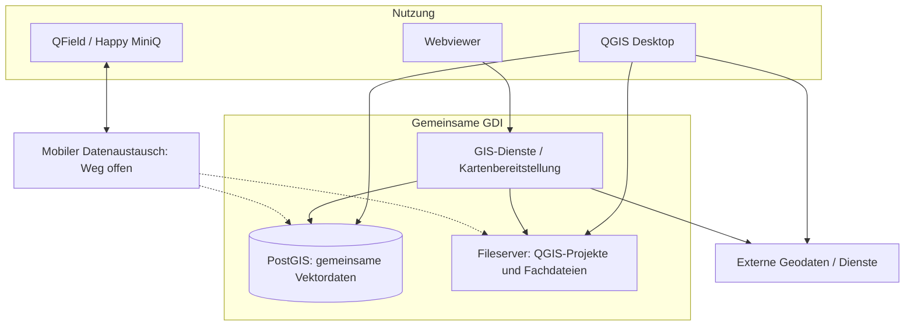

# Zielarchitektur VIC-GDI

**Status:** Interner Arbeitsentwurf · beschlossene Grundsätze und noch offene technische Festlegungen getrennt.

## Logische Architektur

- **Clients:** [QGIS](GLOSSAR.md#qgis) Desktop als Facharbeitsplatz; Webviewer für vereinfachte und erweiterte Kartennutzung; [QField](GLOSSAR.md#qfield)/Happy Mini Q für geeignete mobile Online-/Offline-Szenarien.
- **Daten:** Gemeinsame [PostgreSQL](GLOSSAR.md#postgresql)/[PostGIS](GLOSSAR.md#postgis)-Instanz mit fachbereichsbezogenen Schemas; projektbezogene Zuordnung über `project_id` nur, wo fachlich sinnvoll (A02, A03).
- **Fachprojekte:** QGIS-Projekte bleiben fachbereichs- bzw. projektbezogen; zentral gepflegte Verbindungen, Vorlagen und [QML](GLOSSAR.md#qml)-Stile können wiederverwendet und überschrieben werden (A04, A17).
- **Dienste:** QGIS Server bevorzugt, vorbehaltlich technischem [PoC](GLOSSAR.md#poc); Standard-Webviewer (z. B. Lizmap/QWC2) mit begrenzten Anpassungen; Webpublikation über getrennte Kartenprojekte (A10, A11, A18).
- **Zusatzfunktionen:** Schlanker Suchdienst und logisch separater Extract-Service, in den Webviewer integriert (A12, A20).
- **Betrieb:** On-prem auf Proxmox bevorzugt, hybride Varianten möglich; konkrete Container-/VM-Verteilung mit IT entscheiden (A23, A24).

### Architekturübersicht (logisches Zielbild)

Das Diagramm zeigt die **wesentlichen Nutzungspfade und Datenhaltungen**, ohne einzelne technische Dienste oder Server aufzuschlüsseln. Der mobile Austausch ist noch zu validieren; gestrichelte Linien markieren mögliche, noch nicht festgelegte Zielanbindungen. Identität, Berechtigungen, Betrieb und Deployment gelten übergreifend und sind bewusst nicht als zusätzliche Pfeile dargestellt.

**Lesart:** QGIS Desktop arbeitet je nach Datenart mit PostGIS, Fileservern und externen Diensten. Der Webviewer nutzt GIS-Dienste zur Kartenbereitstellung. Fachdateien verbleiben bei Bedarf auf dem Fileserver; geeignete gemeinsam bearbeitete Vektordaten liegen in PostGIS. Der mobile Rückweg und die Sicherheitsintegration sind noch zu konkretisieren.

## Datenorganisation

- Eine gemeinsame Projektidentität; schlanke Projektstammdaten und optionale räumliche Projektabgrenzung (A06–A08).
- Führende Stelle je gemeinsam genutztem Datenbestand; gemeinsame lesende Nutzung nach Freigabe, Schreibrechte nach Zuständigkeit (A08, A09).
- Gemeinsam bearbeitete geeignete Vektordaten in PostGIS, QGIS-Projekte und geeignete Dateien auf Fileservern; keine pauschale Datenbankpflicht (A36).
- Amtliche externe Daten bevorzugt live nutzen; bei fachlicher Notwendigkeit unveränderliche, nachvollziehbare Datenstände anlegen (A05).
- Externe Rasterdienste bevorzugen; lokale GeoTIFF/COG für Analyse und Reproduzierbarkeit, kein genereller PostGIS-Raster-Zwang (A22).
- ETRS89/UTM EPSG:25832 oder 25833 nach räumlichem Bezug bevorzugen; historische/lokale Projekt-[CRS](GLOSSAR.md#crs) und Höhenreferenzen ausdrücklich berücksichtigen (A21).

## GIS-Funktionen

- **Suche:** Projekte, Orte/Adressen und ausgewählte GIS-Objekte; Ergebnisse nur entsprechend Berechtigung (A20).
- **Auszug:** Autorisierte Layer, Geometrie/Fläche/BBox, Ziel-CRS, GPKG/Shapefile/GeoJSON/CSV. Objektselektion und echtes geometrisches Clipping unterscheiden; technischer PoC erforderlich (A12).
- **Mobil:** Vorhandene Synchronisationsmechanismen verwenden; Konfliktbehandlung und Rückübertragung pilotieren, keine eigene Offline-Engine (A13).
- **[ETL](GLOSSAR.md#etl):** Manuelle Verfahren und Skripte zuerst; kontrollierte Staging-/Importprüfungen, später selektiv automatisieren (A14).
- **Metadaten:** Schlanker Katalog für Quelle, Datensatz und Dienst; je Layer u. a. Herkunft, Datenstand, Lizenz, Importzeit, CRS (A15).
- **Qualität:** Amtliche Daten nur auf technische Import-/Transformationsfehler prüfen; eigene gemeinsame Daten fachlich im normalen Arbeitsprozess plausibilisieren, ohne formalen Freigabeapparat (A16).

## Sicherheits- und Betriebsprinzipien

- Rechte nicht allein über ausgeblendete UI-Elemente, sondern auf den jeweiligen Server-/Datenzugriffspfaden durchsetzen (A09, A26).
- AD/M365-basierte Identitäten und zentraler IdP bevorzugt; konkrete SSO-/QGIS-Desktop-/Externe-Konten-Integration mit IT klären (A25).
- Getrennte TEST-/PROD-Umgebung, versionierte Konfiguration und Datenbankmigrationen, kontrollierte Bereitstellung (A27, A30).
- Bestehende IT-Backups und Monitoring nutzen, um GDI-spezifische Prüfungen und Restore-Tests ergänzen (A28, A29).

## Bewusst nicht festgelegt

Deploymentmodell A24, Details des Identitäts- und Berechtigungsmodells, Datenlebenszyklus A37 und konkrete Datenbankvalidierung A38. Diese Themen sind in [OFFENE_PUNKTE.md](OFFENE_PUNKTE.md) dokumentiert. Nicht jede hier genannte bevorzugte Technologie ist bereits technisch freigegeben.
